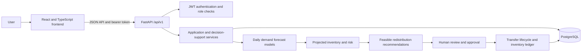

# MedStock Insight

**A Machine Learning-Based Decision Support System for Medicine Stockout Prediction and Inter-Facility Redistribution in the Kenyan Health-Supply-Chain Context.**

MedStock Insight is a web-based operational supply-chain decision-support prototype. It brings together facility and medicine records, inventory transactions, daily demand forecasts, projected stockout-risk assessments, feasible inter-facility redistribution recommendations, and human-controlled transfer tracking.

It is an academic prototype, not a clinical decision-support system. It does not diagnose or treat patients, prescribe medicines, automatically procure stock, or automatically move medicines. It does not connect directly to live KEMSA, eLMIS, KMHFR, or facility systems. Use synthetic or approved anonymized operational data only.

## Project background and objectives

Medicine availability depends on reliable facility-level stock records, useful demand estimates, and coordination when facilities face different supply positions. This project explores how historical consumption, inventory, forecasts, safety stock, confirmed incoming quantities, and feasible donor-recipient matches can support those operational decisions.

The project implements a working web application and evaluates selected forecasting and decision-support mechanisms on synthetic operational data. It is not evidence of clinical impact, national supply-chain performance, or production readiness. See the [technical accuracy review](docs/MEDSTOCK_INSIGHT_TECHNICAL_ACCURACY_REVIEW.md) and [final technical documentation](docs/MEDSTOCK_INSIGHT_MASTER_DOCUMENTATION_FINAL.md) for detailed implementation evidence and qualifications.

## Key capabilities

- Facility and medicine catalogue management.
- Inventory balances, batches, and a transaction ledger.
- Inventory transaction entry and historical consumption analysis.
- Daily medicine-demand forecasting using a seven-day moving average or Random Forest.
- Projected safety-stock-breach and stockout-risk assessment.
- Multi-facility shortage and surplus identification.
- Deterministic, feasible redistribution recommendations, with human review and approval.
- Transfer creation, dispatch, receipt/completion, cancellation rules, and tracking.
- Dashboard, operational reporting, scenario analysis, and decision analytics.
- Audit events and persisted application settings.

The facility identities in the demonstration set are sourced from KMHFR and medicine catalogue metadata from KEML 2023 where indicated. Inventory, consumption, procurement, accounts, and transfers are synthetic demonstration records. The reference source and data-generation limits are described in [docs/kenya-data.md](docs/kenya-data.md) and [docs/kenya-data-quality-report.md](docs/kenya-data-quality-report.md).

## System workflow

1. Users maintain facilities, medicines, batches, and inventory.
2. Inventory movements are recorded in the transaction ledger; consumption is derived from ledger transactions.
3. The forecasting component estimates future daily demand from historical consumption.
4. The risk engine projects inventory using current stock, daily forecasts, safety stock, and dated confirmed incoming quantities.
5. The redistribution engine identifies projected shortages and feasible donor surplus, then records a recommendation.
6. An authorized user reviews and approves or rejects the recommendation.
7. An approved recommendation can be turned into a transfer. Dispatch and receipt are separate, human-controlled actions.
8. Ledger movements, audit events, dashboards, and reports provide operational visibility.

Forecasting, risk assessment, recommendation, approval, and physical transfer execution are separate stages. A forecast or recommendation does not itself change inventory.

## Architecture

The project is a modular monolith with a FastAPI backend, React single-page frontend, and PostgreSQL database. The frontend calls versioned JSON endpoints under `/api/v1`; the backend authenticates users with bearer JWTs, applies server-side role checks, and reads or writes application state through SQLAlchemy. Alembic manages schema changes. Forecasting and decision-support calculations run in backend services.



## Technology stack

| Area | Implemented technologies |
|---|---|
| Backend | Python 3.11+, FastAPI, SQLAlchemy 2, Alembic, Pydantic 2, psycopg 3 |
| Authentication | JWT (`PyJWT`), Argon2 password hashing through `pwdlib` |
| Machine learning | scikit-learn Random Forest and a moving-average baseline |
| Database | PostgreSQL 17 in the supplied Docker Compose workflow |
| Frontend | React 19, TypeScript, Vite 8, Recharts, Tailwind CSS 4 |
| Frontend development | npm, Vitest, Testing Library, Oxlint |
| Backend development | uv, pytest, Ruff |

Dependency ranges and scripts are declared in [`pyproject.toml`](pyproject.toml), [`uv.lock`](uv.lock), [`frontend/package.json`](frontend/package.json), and [`frontend/package-lock.json`](frontend/package-lock.json).

## Main modules

- **Inventory and consumption:** transaction ledger, current balance representation, batch records, and filtered consumption history.
- **Forecasts and models:** daily forecast generation and forecast evaluation/diagnostics.
- **Stockout risk:** projected inventory trajectory and risk explanation.
- **Redistribution:** facility-level projected surplus and shortage, candidate feasibility, recommendation generation, review, and explanation.
- **Transfers:** approval-backed transfer creation and tracked dispatch/receipt lifecycle.
- **Operations and administration:** dashboard, facilities, medicines, audit events, system settings, scenarios, and aggregate decision analytics.

## Machine learning and evaluation

The operational forecast models are `MOVING_AVERAGE_7D` and `RANDOM_FOREST`. The moving-average forecast uses the latest seven observations. The Random Forest uses lag-one and lag-seven consumption, seven- and 28-day rolling means, and day of week; its configured operational regressor uses 200 trees and a fixed random seed. The API accepts forecast horizons from 1 to 90 days and applies history sufficiency checks. The operational Random Forest forecast is recursively generated across the requested horizon.

The research evaluation is a distinct process: when a series has sufficient observations, it evaluates one-step predictions over the final 14 days in chronological order, using a 42-day minimum training window. Earlier holdout actuals are made available to later one-step predictions, while the Random Forest is not refit on the holdout. The evaluation reports MAE, RMSE, WAPE where defined, and observation counts. These results describe the available synthetic data and evaluation design; they do not establish real-world accuracy or model superiority. See [Phase 9 assumptions](docs/phase9_scenarios.md) and [Phase 10 experiments](docs/phase10_experiments.md).

## Inventory, risk, and redistribution logic

`inventory_transactions` is the inventory movement ledger; `inventory_balances` is the current-state representation maintained alongside movements. Consumption history is derived from `CONSUMPTION` ledger transactions. Risk projection begins with current inventory, adds confirmed or partially received purchase-order quantities on expected delivery dates, and subtracts forecast demand day by day. It records a safety-stock breach separately from a projected zero-stock date. Risk bands are project-defined operational thresholds (Critical: current stockout or breach within 5 days; High: 6–10; Medium: 11–15; Low: no breach in the selected horizon), not Kenyan regulatory or clinical standards.

Although `lead_time_days` is stored on the facility-medicine policy, the current risk calculation does **not** use it. Dated incoming purchase orders affect the projection independently; this does not implement lead-time-aware risk or replenishment calculations.

Redistribution is a deterministic feasibility mechanism, not a network-wide mathematical optimization solver. It calculates projected donor surplus while retaining source safety stock, calculates destination projected shortage while accounting for confirmed incoming stock, selects the eligible donor with the largest feasible surplus, and bounds the recommended quantity by both surplus and shortage. Recommendations are revalidated for key stock and policy conditions at approval and require human review. They do not execute a physical transfer.

## Roles and access limitations

The implemented roles are `ADMINISTRATOR`, `SUPPLY_CHAIN_MANAGER`, and `INVENTORY_OFFICER`. The backend enforces role checks on protected routes; selected inventory, consumption, and transfer-completion workflows also scope actions to the assigned facility. Facility-level read isolation is not consistently enforced across all list, dashboard, analytics, forecast, risk, audit, and redistribution surfaces. This is a material security limitation: do not treat this prototype as ready for unrestricted live multi-facility deployment. Consult Section 10 of the [final technical documentation](docs/MEDSTOCK_INSIGHT_MASTER_DOCUMENTATION_FINAL.md) for the detailed permissions matrix and caveats.

| Capability | Administrator | Supply chain manager | Inventory officer |
|---|:---:|:---:|:---:|
| Authenticated read routes | Yes | Yes | Yes; facility filtering is inconsistent |
| Record ordinary inventory movements | Yes | No | Yes, assigned facility only |
| Generate forecasts and risk assessments | Yes | Yes | No |
| Generate/review redistribution recommendations | Yes | Yes | No |
| Create, dispatch, or cancel transfers | Yes | Yes | No |
| Complete a transfer | Yes | Yes | Yes, only at assigned destination facility |
| Create facility/medicine records; list demo users | Yes | No | No |

Route-specific authorization remains authoritative; this table is a summary of the implemented backend checks.

## Transfer lifecycle and audit

Transfers progress through `APPROVED → IN_TRANSIT → COMPLETED`. Dispatch records a source `TRANSFER_OUT`; completion records a destination `TRANSFER_IN`. Completion and inventory movement are handled transactionally by the backend. Cancellation is rejected once a transfer is in transit because stock has already left the source. Audit events identify actors and relevant state changes, but the audit log is not claimed to be tamper-proof.

## Database and data model

Alembic migrations create and evolve the PostgreSQL schema. Core entities include users and roles, facilities, medicines and categories, facility-medicine policies, batches, current inventory balances, inventory transactions, purchase orders and items, model versions, forecast runs and points, risk assessments, redistribution recommendations and transfers, audit events, and system settings. The migration chain is in [`alembic/versions/`](alembic/versions/).

The included seed is for a local synthetic demonstration database. It is idempotent for the operational data it manages and avoids reseeding existing synthetic ledger history. Do not point it at a live or valuable database.

## Repository structure

```text
app/                         FastAPI routes, models, schemas, and services
alembic/                     Database migration configuration and revisions
scripts/                     Seed, evaluation, data-quality, and verification tools
data/                        Reference catalogue input
tests/                       Backend test suite
frontend/                    React, TypeScript, Vite application and tests
docs/                        Technical, data, and phase documentation
docker-compose.yml           Local PostgreSQL service
pyproject.toml / uv.lock     Backend dependencies and lockfile
```

## Prerequisites

Required for the recommended Docker database workflow:

- Git.
- Python 3.11 or newer.
- [`uv`](https://docs.astral.sh/uv/) for the locked Python environment and commands.
- Node.js 24.15+ (or 26+) and npm. These satisfy the Node engine requirements in the checked-in frontend lockfile; Node 24 LTS is a suitable choice.
- Docker Engine with Docker Compose v2 on Linux, or Docker Desktop with Compose on Windows/macOS.

Check versions:

```sh
git --version
python --version
uv --version
node --version
npm --version
docker --version
docker compose version
```

Native PostgreSQL may be used instead of Docker, but then the server/database/role must be created separately and the local connection settings must match `.env`. Docker is the documented default.

## Environment configuration

1. From the repository root, copy `.env.example` to a private `.env` (`Copy-Item .env.example .env` in PowerShell or `cp .env.example .env` in Bash).
2. Edit `.env` locally. Set `POSTGRES_PASSWORD` to a strong local database password and use the same password in `DATABASE_URL`. URL-encode special characters in the URL password component.
3. Set `MEDSTOCK_DEMO_PASSWORD` to a local demonstration password of at least 12 characters. Do not reuse a personal or production password.
4. Keep `.env` private. It is ignored by Git. Never commit it or paste its contents into issues, chat, logs, or screenshots.

| Variable | Purpose |
|---|---|
| `APP_NAME`, `ENVIRONMENT`, `DEBUG` | API label and runtime mode. Keep `DEBUG=false` for normal local use. |
| `DATABASE_URL` | SQLAlchemy PostgreSQL connection. Docker Compose publishes the database at `127.0.0.1:15431`. |
| `POSTGRES_PASSWORD` | Password used by Compose when it initializes a new PostgreSQL data directory. Must agree with the URL credential. |
| `MEDSTOCK_DEMO_PASSWORD` | Password hashed for synthetic demo accounts when those accounts are first created. |
| `JWT_SECRET_KEY` | Optional for local development; without it a process-specific ephemeral signing key is used. Set a generated random value for persistent local sessions or multi-worker use. It is required outside development/test/demo environments. |
| `JWT_ALGORITHM`, `ACCESS_TOKEN_EXPIRE_MINUTES` | Token configuration; the implementation supports `HS256` and requires a positive expiry. |
| `CORS_ORIGINS` | Comma-separated explicit browser origins. The example permits the standard local Vite origins. |

The frontend has an optional `VITE_API_BASE_URL` setting. Its code default is `http://127.0.0.1:8000/api/v1`. To override it, create `frontend/.env.local` with, for example, `VITE_API_BASE_URL=http://127.0.0.1:8000/api/v1`, then restart Vite. Do not put secrets in `VITE_*` variables: they are bundled for the browser.

## Quick start: complete local installation

Run these steps from the repository root. Keep the API and frontend running in separate terminals.

1. Clone the project and enter its root:

   ```sh
   git clone https://github.com/Gideon-Kiprotich/MedStock-Insight.git
   cd MedStock-Insight
   ```

2. Copy `.env.example` to `.env`, set the local database and demo passwords, and verify `DATABASE_URL` uses port `15431`.
3. Start only PostgreSQL:

   ```sh
   docker compose up -d postgres
   docker compose ps
   ```

4. Install and sync backend dependencies:

   ```sh
   uv sync --extra dev
   ```

5. Apply migrations and seed the demo data:

   ```sh
   uv run --env-file .env alembic upgrade head
   uv run --env-file .env python scripts/seed.py
   ```

6. In terminal 1, start the backend:

   ```sh
   uv run --env-file .env uvicorn app.main:app --reload --host 127.0.0.1 --port 8000
   ```

   Check `http://127.0.0.1:8000/health`; interactive API documentation is at `http://127.0.0.1:8000/docs`.

7. In terminal 2, install and start the frontend:

   ```sh
   cd frontend
   npm ci
   npm run dev -- --host 127.0.0.1
   ```

8. Open the Vite URL shown in the terminal, normally `http://127.0.0.1:5173`, and sign in with the demo account below.

The repository does not define a single command that starts the database, API, and frontend together. Keep Docker, the API terminal, and the frontend terminal running while using the application.

## Operating-system setup

The quick start above is the same workflow on all three platforms. The following commands show the platform-specific shell syntax; run them from the cloned repository root unless a command says otherwise.

### Windows (PowerShell)

Install Git, Python 3.11+, uv, Node.js 24.15+ (or 26+), and Docker Desktop with Compose v2. Then:

```powershell
git clone https://github.com/Gideon-Kiprotich/MedStock-Insight.git
Set-Location MedStock-Insight
Copy-Item .env.example .env
# Edit .env in a local editor; do not paste secrets into the terminal history.
docker compose up -d postgres
uv sync --extra dev
uv run --env-file .env alembic upgrade head
uv run --env-file .env python scripts/seed.py
```

Start the backend in one PowerShell window:

```powershell
uv run --env-file .env uvicorn app.main:app --reload --host 127.0.0.1 --port 8000
```

Start the frontend in another PowerShell window:

```powershell
Set-Location path\to\MedStock-Insight\frontend
npm ci
npm run dev -- --host 127.0.0.1
```

### Linux (Bash)

Install Git, Python 3.11+, uv, Node.js 24.15+ (or 26+), and Docker Engine with the Compose v2 plugin. On some distributions, Docker commands require membership in the `docker` group or `sudo`; follow the distribution’s Docker setup guidance.

```bash
git clone https://github.com/Gideon-Kiprotich/MedStock-Insight.git
cd MedStock-Insight
cp .env.example .env
# Edit .env with your local editor.
docker compose up -d postgres
uv sync --extra dev
uv run --env-file .env alembic upgrade head
uv run --env-file .env python scripts/seed.py
```

Use separate terminal windows for:

```bash
uv run --env-file .env uvicorn app.main:app --reload --host 127.0.0.1 --port 8000
```

```bash
cd frontend
npm ci
npm run dev -- --host 127.0.0.1
```

### macOS

Install Git, Python 3.11+, uv, Node.js 24.15+ (or 26+), and Docker Desktop for Mac with Compose v2. Homebrew is one possible installer for command-line tools, but it is not required by the project itself.

```bash
git clone https://github.com/Gideon-Kiprotich/MedStock-Insight.git
cd MedStock-Insight
cp .env.example .env
# Edit .env with your local editor.
docker compose up -d postgres
uv sync --extra dev
uv run --env-file .env alembic upgrade head
uv run --env-file .env python scripts/seed.py
```

Use separate terminal windows for:

```bash
uv run --env-file .env uvicorn app.main:app --reload --host 127.0.0.1 --port 8000
```

```bash
cd frontend
npm ci
npm run dev -- --host 127.0.0.1
```

## Database configuration and native PostgreSQL alternative

The supported Docker Compose service is named `postgres` in the root `docker-compose.yml`. It uses PostgreSQL 17, database `medstock`, role `medstock`, the ignored root `.env` for `POSTGRES_PASSWORD`, and the named volume `medstock_pgdata`. It binds to loopback port `15431` on the host and PostgreSQL port `5432` inside the container. Start it with `docker compose up -d postgres` and stop it with `docker compose stop postgres`.

For native PostgreSQL, create a database and role named `medstock`, set a password, and update `DATABASE_URL` in `.env` to the native server address (commonly `127.0.0.1:5432`). Set `POSTGRES_PASSWORD` as needed for Compose only; native PostgreSQL does not consume that setting. Then run the same Alembic migration and seed commands. No database reset is needed for normal startup.

## Demo account and password behavior

The seed creates synthetic users including:

- Email: `grace.njeri.demo@medstock.example`
- Password: the value of `MEDSTOCK_DEMO_PASSWORD` when the user was first created in that database.

Changing `MEDSTOCK_DEMO_PASSWORD` and rerunning the seed does **not** change an existing user's password hash. The seed only uses the configured password when creating a missing demo account. To recover access, use a local disposable development database and create a fresh database/account set only if you are prepared to lose that database’s local data; alternatively, have an authorized administrator perform a deliberate password-hash update using the project’s `hash_password` utility in a reviewed local maintenance operation. Do not delete or reset a database containing data you need. The repository has no dedicated demo-password reset command or public password-reset endpoint. Never share the configured password.

For a local database you administer, the following interactive maintenance procedure resets only the synthetic administrator account, preserves other database records, and prompts for the new password without echoing it or placing it in shell history. Run it from the repository root after configuring `.env`:

```sh
uv run --env-file .env python
```

At the Python prompt, enter:

```python
from getpass import getpass
from sqlalchemy import select
from app.core.security import hash_password
from app.db.session import SessionLocal
from app.models.core import User

email = "grace.njeri.demo@medstock.example"
new_password = getpass("New demo password (12+ characters): ")
if len(new_password) < 12:
    raise ValueError("Password must contain at least 12 characters")
with SessionLocal() as db:
    user = db.scalar(select(User).where(User.email == email, User.is_demo_user.is_(True)))
    if user is None:
        raise LookupError("The seeded demo administrator was not found")
    user.password_hash = hash_password(new_password)
    db.commit()
```

Exit with `exit()`, then sign in using the new password. This procedure changes only the selected account’s hash; it is not a substitute for a production password-reset workflow.

All seeded identities are synthetic and use reserved `.example` email addresses. Do not use them for live operations.

## Tests and developer checks

Run backend tests from the repository root:

```sh
uv run --env-file .env pytest -q
```

The suite includes SQLite-backed API/service tests and PostgreSQL-specific hardening checks. The latter require a PostgreSQL connection and may need a separate test database configured as the test expects; inspect `tests/test_postgres_hardening.py` before running against a database. Never point destructive test setup at valuable data.

Run backend lint:

```sh
uv run ruff check .
```

Run frontend checks from the repository root:

```sh
npm --prefix frontend test
npm --prefix frontend run lint
npm --prefix frontend run build
```

These are validation/development commands, not required on every application start. Frontend dependencies must first be installed with `npm ci`.

## API and useful endpoints

All application API routes are versioned under `/api/v1` and use JSON. Authenticate with `POST /api/v1/auth/login`, then send the returned bearer token in the `Authorization` header.

| Endpoint | Purpose |
|---|---|
| `GET /health` | Basic API health response; does not test every database operation. |
| `GET /docs` | Interactive OpenAPI documentation. |
| `POST /api/v1/auth/login` | Exchange email and password for an access token. |
| `GET /api/v1/auth/me` | Read the authenticated user. |
| `/api/v1/inventory` and `/api/v1/inventory/transactions` | Inventory and transaction ledger. |
| `/api/v1/consumption` | Filtered consumption history. |
| `/api/v1/forecasts` and `/api/v1/models` | Forecast runs, generation, explanations, and model metadata. |
| `/api/v1/risk-assessments` | Projected inventory-risk records and explanations. |
| `/api/v1/redistributions` | Surplus, shortage, recommendation, review, and explanation endpoints. |
| `/api/v1/transfers` | Transfer tracking and lifecycle actions. |
| `/api/v1/dashboard`, `/api/v1/decision-analytics` | Dashboard and decision analytics. |
| `/api/v1/settings` and `/api/v1/audit` | Settings and audit records, subject to role checks. |

The full route inventory and request/response details are in the [technical documentation](docs/MEDSTOCK_INSIGHT_MASTER_DOCUMENTATION_FINAL.md).

## Troubleshooting

### “Failed to fetch” on login or dashboard

This usually means the browser cannot reach the API, before it can receive a normal login error. Confirm:

1. The backend is running at `http://127.0.0.1:8000` and `GET /health` returns `{"status":"ok",...}`.
2. The frontend API base is `http://127.0.0.1:8000/api/v1` (the code default) or a correct `VITE_API_BASE_URL`; restart Vite after changing it.
3. `CORS_ORIGINS` includes the exact frontend origin shown in the browser, including hostname and port. The example includes the default local Vite origins.
4. The backend started successfully and can connect to PostgreSQL. Review the API terminal for startup or database errors.

An invalid password normally returns HTTP 401; it does not by itself cause a network-level “Failed to fetch”.

### Database connection refused or Compose is not ready

- Check `docker compose ps` and `docker compose logs postgres`.
- Confirm `.env` contains a `POSTGRES_PASSWORD` and that `DATABASE_URL` uses the same password and host port `15431` for the supplied Compose mapping.
- Wait for PostgreSQL to finish starting, then rerun the migration.
- If host port `15431` is occupied, choose an unused host port in `docker-compose.yml` and use the same port in `DATABASE_URL`. Keep the Compose container port as `5432`.
- If you changed `POSTGRES_PASSWORD` after the named database volume was initialized, changing the environment variable does not alter the existing PostgreSQL role password. Align the database role credential with `.env` using a local authorized PostgreSQL administration session; do not delete the volume as routine troubleshooting.

### Missing environment variables or JWT configuration errors

Run backend commands from the repository root and include `--env-file .env` where shown. Confirm the file is named `.env`, exists at the root, and was copied from `.env.example`. Quote values containing spaces, such as `APP_NAME="MedStock Insight API"`, so `uv --env-file` parses them cleanly. Do not print the file to troubleshoot. If a parent shell exports conflicting settings (for example `DEBUG`), those environment values may override `.env`; remove or correct the conflicting export in that terminal and restart the backend.

### Alembic or missing demo user

- Confirm PostgreSQL is running and `DATABASE_URL` points to the intended local database.
- Apply `uv run --env-file .env alembic upgrade head` before seeding.
- Run `uv run --env-file .env python scripts/seed.py` and read any validation error in the terminal.
- The seed requires `MEDSTOCK_DEMO_PASSWORD` to be at least 12 characters.
- If the user already exists, reseeding does not reset the password. Follow the demo-account recovery guidance above; do not reset the whole database unless it is disposable and you have chosen to lose its contents.

### Frontend install errors or port conflicts

- Use a supported Node version from the prerequisites and run `npm ci` inside `frontend` (or `npm --prefix frontend ci` from the root).
- If Vite reports port `5173` is busy, stop the process using it or use Vite’s printed alternate URL; make sure the selected origin is permitted by backend `CORS_ORIGINS`.
- If port `8000` is busy, start Uvicorn on another port and update `VITE_API_BASE_URL` to match.

## Security, deployment, and limitations

- `.env`, JWT signing keys, database passwords, and demo passwords are secrets; keep them out of version control and logs.
- The default local CORS list and ephemeral development JWT key are for local development only. Use an explicit persistent signing key and reviewed deployment configuration outside local development.
- JWTs are stored by the frontend in browser `localStorage`, which is accessible to scripts running in that origin.
- Facility-level data isolation is incomplete across read interfaces, as described above. The prototype is not ready for unrestricted live multi-facility deployment.
- `lead_time_days` is not consumed by the implemented risk calculation.
- Forecast quality depends on the available history; demonstrated evaluation uses synthetic data and does not establish field performance.
- Redistribution is deterministic and feasibility-oriented, not globally optimal. Human approval and physical transfer operations remain separate.
- The audit trail supports accountability but is not tamper-proof.
- There is no direct live integration with KEMSA, eLMIS, or other national systems, and the application does not handle patient-level data.

Future work could include consistent facility-level authorization, lead-time-aware risk analysis, broader external validation, operational deployment controls, and carefully governed integrations.

## Project documentation

- [Final master technical documentation](docs/MEDSTOCK_INSIGHT_MASTER_DOCUMENTATION_FINAL.md)
- [Independent technical accuracy review](docs/MEDSTOCK_INSIGHT_TECHNICAL_ACCURACY_REVIEW.md)
- [Kenya data sources and assumptions](docs/kenya-data.md)
- [Kenya data quality report](docs/kenya-data-quality-report.md)
- [Phase 9 scenario assumptions](docs/phase9_scenarios.md)
- [Phase 10 experiments and reproducibility](docs/phase10_experiments.md)
- [Phase 11 hardening and verification](docs/phase11_hardening.md)
- [Reference project proposal](docs/reference/Medicine_Stockout_Prediction_Final_Year_Project_Proposal.docx)

## License and acknowledgements

No license file is currently provided; no license terms are asserted here. The project references Kenya Master Health Facility Registry facility metadata and Kenya Essential Medicines List 2023 catalogue information as recorded in the project’s data documentation. Synthetic operational records are project-generated and should not be interpreted as official facility statistics.
