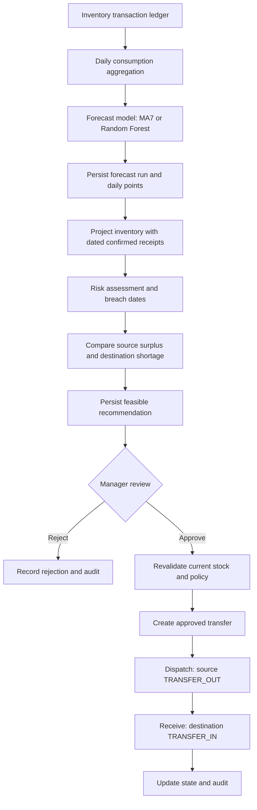
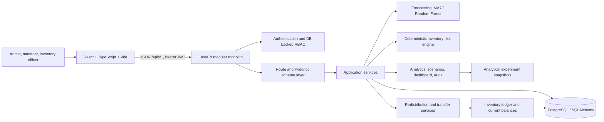
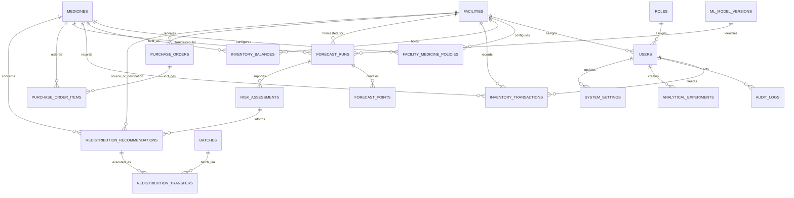

# MedStock Insight — Master Technical Documentation

- **Formal academic project title (approved proposal):** *A Machine Learning-Based Decision Support System for Medicine Stockout Prediction and Inter-Facility Redistribution in the Kenyan Health-Supply-Chain Context*
- **Product:** MedStock Insight
- **Documentation snapshot:** 2 November 2026
**Repository examined:** nested `medstock-insight` Git repository, branch `main`, commit `0215b2522f1349150a5772654a7d206a9cc136b2` (`feat: complete consumption log and system settings modules`)

> **Demonstration environment:** Operational balances, consumption, procurement, users, approvals, batches, and transfers in the seeded environment are synthetic. The facility and medicine catalogue contains sourced reference information. The system is a supply-chain decision-support prototype, not a clinical system or live national integration.

## Contents

- [Part I — Project overview](#part-i--project-overview)
- [Approved proposal alignment](#4-approved-proposal-objectives-research-questions-and-implementation-traceability)
- [Part II — Development history](#part-ii--development-history)
- [Part III — Requirements and design](#part-iii--requirements-and-design)
- [Part IV — Architecture and runtime](#part-iv--architecture-and-runtime)
- [Part V — Database design](#part-v--database-design)
- [Part VI — Backend and API](#part-vi--backend-and-api)
- [Part VII — Machine learning and analytics](#part-vii--machine-learning-and-analytics)
- [Part VIII — Frontend](#part-viii--frontend)
- [Part IX — Testing and evaluation](#part-ix--testing-and-evaluation)
- [November 2 release verification](#331-november-2-2026-post-phase-11-release-verification)
- [Part X — Limitations and future work](#part-x--limitations-and-future-work)
- [Appendices](#appendices)

# Part I — Project overview

## 1. Document purpose and conventions

This document is the evidence-based technical reference for preparing the final-year academic report and for onboarding engineers or examiners. It describes the approved proposal baseline, the implementation history that can be reconstructed from the repository, and the application state reported at the 2 November 2026 release checkpoint. It is not a replacement for the formal dissertation, user guide, or deployment runbook. The approved proposal is `Medicine_Stockout_Prediction_Final_Year_Project_Proposal.docx` (September 2026); the formal title and verbatim objectives/research questions below follow that proposal.

Implementation status uses these labels:

- **IMPLEMENTED AND VERIFIED** — present in source and supported by automated or recorded verification evidence. “Verified” refers to the cited scope and date; it does not imply production validation.
- **IMPLEMENTED, NOT FULLY VERIFIED** — present in source, but evidence does not cover all relevant behaviours or deployment conditions.
- **PARTIALLY IMPLEMENTED** — some capability exists while important operations, controls, or workflows are absent.
- **PLANNED / NOT IMPLEMENTED** — described as an objective or expected capability but not present in the inspected application.
- **DEPRECATED OR SUPERSEDED** — an earlier approach has been replaced or retained only for compatibility/history.

Evidence references use repository-relative paths and commit hashes. The source code and migration graph define current implementation; tests and scripts define tested behaviour; Git commits establish chronology only for their recorded changes; existing technical notes provide historical verification context. The initial commit groups much of the original implementation into one snapshot, so not every feature can be assigned a separate historical date or phase. No accessible task-history record added verifiable dates or milestone details.

This documentation refinement uses the inspected master dossier, the approved September 2026 proposal, the repository-history facts recorded in the dossier, and the QA/release results supplied during the project handoff. Application tests and external services were not rerun while refining this document. Historical Phase 11 results are kept separate from the later 2 November 2026 Consumption Log/System Settings release-checkpoint results. The latter are recorded as reported QA evidence, not as tests independently executed during this documentation edit.

## 2. Project identity

MedStock Insight is a modular-monolith web application for medicine inventory operations and planning. Its formal academic title is about medicine stockout prediction and inter-facility redistribution; the implemented analytical workflow uses daily demand forecasting, deterministic projected-inventory risk assessment, and feasible redistribution recommendations in the Kenyan health-supply-chain context.

The intended users are administrators, supply-chain managers, and facility inventory officers. The prototype supports a demonstration network of facilities, catalogue items, balances and ledger transactions, forecasts, projected risks, recommendations, human review, transfer state tracking, dashboard views, consumption history, audit review, and a small number of persisted system defaults.

The implementation uses reference records from the Kenya Master Health Facility Registry (KMHFR) and Kenya Essential Medicines List (KEML) 2023 where sourced. Synthetic operational records are used for demonstration and evaluation. It does not connect to KEMSA ordering, eLMIS, KMHFR live services, or facility information systems.

## 3. Problem context and motivation

Medicine demand varies over time and across facilities. A decision-maker needs to compare current stock with consumption history, account for expected receipts, identify projected safety-stock or stockout breaches, and judge whether another facility has stock available while retaining its own safety margin. A ledger and attributable actions also matter when stock is received, consumed, adjusted, dispatched, or received from another facility.

The project explores whether historical transaction data, simple forecasting, transparent inventory projection, and a human-reviewed recommendation workflow can make those decisions easier to inspect. These are design motivations, not measured claims about all Kenyan facilities, current national stock visibility, or the performance of existing health systems.

The current application provides simulated operational data and a reference catalogue. It does not prove that real facilities share data, that synthetic patterns represent Kenyan consumption, or that a proposed transfer is logistically authorized or clinically appropriate.

## 4. Approved proposal objectives, research questions, and implementation traceability

The approved September 2026 proposal was available for this refinement. The formal wording below is transcribed from Sections 7–9 of that proposal (printed page 8). These statements are the academic baseline; implementation status is assessed separately against the technical evidence in this dossier.

### 4.1 Main objective

> To design, develop, and evaluate a machine learning-based decision-support system that forecasts medicine demand, assesses stockout risk, and recommends inter-facility redistribution actions using historical consumption and inventory data in the Kenyan health-supply-chain context.

### 4.2 Specific objectives

1. To analyse medicine inventory, consumption, replenishment, and stockout variables relevant to facility-level medicine availability.
2. To design and develop a centralized inventory-management module for facilities, medicines, batches, transactions, and consumption records.
3. To develop and compare selected demand-forecasting models using historical facility-level medicine consumption data.
4. To develop a stockout-risk assessment mechanism that uses daily demand forecasts together with current inventory, confirmed incoming stock, safety stock, replenishment lead time, and relevant historical information.
5. To develop an inter-facility redistribution recommendation mechanism that identifies projected shortages and usable surplus while enforcing explicit inventory constraints.
6. To develop a decision-support dashboard and alert system that presents forecasts, stockout-risk information, surplus, and redistribution recommendations to authorized users.
7. To evaluate the predictive and operational performance of the proposed approach against conventional forecasting and inventory baselines using temporal test data.

### 4.3 Research questions

1. Which inventory, consumption, and supply-chain variables are useful for forecasting medicine demand and identifying potential stockout conditions?
2. How accurately can selected statistical and machine-learning methods forecast daily medicine consumption at facility level?
3. How effectively can forecast demand, current stock, replenishment lead time, safety stock, and incoming stock be combined to identify the timing and magnitude of potential stockouts?
4. How can projected shortages and multi-facility surplus be combined to produce feasible inter-facility redistribution recommendations?
5. How effectively can predictive information and redistribution recommendations be presented through a decision-support interface to authorized users?
6. How does the proposed predictive approach compare with conventional demand-forecasting and reorder-point baselines on unseen temporal data?

### 4.4 Objective-to-implementation traceability

| Proposal objective | Implemented evidence | Status and qualification |
|---|---|---|
| 1. Analyse inventory, consumption, replenishment and stockout variables | Synthetic generator, facility-medicine policies, transaction ledger, purchase-order records, forecast features, risk inputs and data-quality scripts | **PARTIALLY IMPLEMENTED.** The system represents and analyses these variables using synthetic operational data. A separately documented exploratory analysis of an approved real operational dataset is not available. |
| 2. Develop centralized inventory management for facilities, medicines, batches, transactions and consumption | Facility/medicine modules, inventory balances and ledger, consumption history, batch model and transfer-time batch/expiry checks | **PARTIALLY IMPLEMENTED.** Core inventory and consumption workflows exist. Batch lifecycle management is incomplete because there is no general batch CRUD API/UI; full facility/medicine editing workflows are also limited. |
| 3. Develop and compare selected demand-forecasting models | MOVING_AVERAGE_7D and RANDOM_FOREST, daily persisted forecasts, model versions, temporal holdout evaluation and synthetic multi-series evaluation scripts | **IMPLEMENTED AND VERIFIED under synthetic evaluation conditions.** No real facility demand validation is established. |
| 4. Develop forecast-based stockout-risk assessment using inventory, incoming stock, safety stock, lead time and historical information | Deterministic projection consumes current balance, daily forecast points, policy thresholds and dated confirmed/partially received incoming order quantities; risk snapshots preserve relevant inputs | **IMPLEMENTED, WITH A LEAD-TIME TRACEABILITY CHECK REQUIRED.** The policy schema stores `lead_time_days`, but the available technical description of `calculate_risk()` does not establish exactly how that field affects the risk result. Confirm the direct calculation dependency in source before claiming lead-time-aware classification. |
| 5. Recommend inter-facility redistribution using projected shortage, usable surplus and constraints | Candidate-position calculation, source safety-stock protection, recipient incoming-stock adjustment, constrained quantities, recommendation snapshot/revalidation and human review | **IMPLEMENTED AND VERIFIED for controlled synthetic scenarios.** This is a feasibility/rules engine, not a proven optimization solver. |
| 6. Provide dashboard and alert system | Dashboard, Stockout Risk and Decision Analytics views present saved risks, forecasts, surplus/shortage positions and recommendations | **PARTIALLY IMPLEMENTED.** The decision-support views exist, but there is no separate persisted alert table, alert-management API or full acknowledgement workflow. |
| 7. Evaluate predictive and operational performance against forecasting and inventory baselines | Temporal MA7-versus-Random-Forest evaluation, risk scenarios, redistribution constraint checks and network analytics | **PARTIALLY IMPLEMENTED.** Forecasting baseline comparison is implemented. A separate measured comparison against a conventional reorder-point/safety-stock operational baseline is not demonstrated in the available evaluation evidence. |

### 4.5 Research-question evidence map

| Research question | Evidence available in the implementation | What remains to answer it academically |
|---|---|---|
| RQ1 — Which variables are useful? | Lagged consumption, rolling averages, weekday/calendar signals, current inventory, policies, incoming orders and synthetic supply events are represented. | Analyse feature relevance and data quality transparently; do not infer causal importance from the presence of a feature in the code. |
| RQ2 — How accurately can models forecast daily consumption? | MA7 and Random Forest temporal evaluation with MAE, RMSE and WAPE on eligible synthetic facility-medicine series. | Produce final evaluation tables/plots and interpret errors, sparse series and model failures. No real-data accuracy claim is supported. |
| RQ3 — How effectively can inputs identify stockout timing/magnitude? | Deterministic risk projection and controlled scenarios use stock, forecast demand, safety policy and incoming quantities. | Compute detection rate, missed-stockout rate, warning time and projected-shortage error against explicitly defined scenario/event truth. |
| RQ4 — How can shortages and surplus yield feasible recommendations? | Multi-facility candidate calculations, constraints, approval revalidation and transfer workflow. | Report constraint compliance and shortage coverage across controlled scenarios; do not call recommendations optimal. |
| RQ5 — How effectively is information presented to authorized users? | Role-aware screens, browser smoke verification and responsive desktop/mobile checks are reported. | A formal usability/user-acceptance study with representative users has not been established. |
| RQ6 — How does the predictive approach compare with conventional forecasting and reorder-point baselines? | MA7 versus Random Forest temporal comparison is implemented. | Complete or explicitly scope the conventional reorder-point/safety-stock operational baseline comparison before claiming the full comparison objective is satisfied. |

**Academic interpretation:** the software artefact implements much of the proposed workflow, but implementation completion and research-question resolution are different. The final report must present measured results, limitations and unresolved comparisons rather than treating the existence of a feature as evidence of effectiveness.

## 5. Scope, assumptions, and exclusions

**Functional scope:** authenticated views and supported writes for inventory transactions, forecast/risk generation, recommendation creation and review, transfer tracking, dashboard and decision analytics, consumption history, audit access, basic catalogue/facility creation, demo-user listing, and system defaults.

**Technical scope:** FastAPI JSON API, SQLAlchemy persistence, Alembic migrations, PostgreSQL runtime target, React/TypeScript/Vite interface, offline-style synthetic data generation and evaluation scripts. SQLite is used by isolated tests and migration-compatibility checks; this does not replace PostgreSQL concurrency verification.

**Data scope:** sourced facility and medicine reference metadata plus synthetic operational ledgers and synthetic user personas. No patient-level clinical data is modeled. “Facility eligible for transfer” is project configuration, not authorization from that facility.

**Operational assumptions:** quantities use a medicine’s configured unit; a facility-medicine pair can have a safety stock/reorder policy; confirmed or partially received purchase orders can provide dated incoming quantities; staff review recommendations; stock movements are recorded through ledger-backed transactions. Risk thresholds are project-defined, not clinical or regulatory thresholds.

**Human-in-the-loop boundary:** a recommendation is not a transfer. An authorized manager must approve or reject it; a transfer then has separate create, dispatch, and receive operations. The application does not physically move stock or procure automatically.

**Excluded:** diagnosis, prescribing, patient management, clinical decision support, autonomous procurement, automatic physical transfers, national system integration, live supplier integration, and a validated real-world demand model. There is no general purchase-order CRUD API, no batch-management API, no alert API/table, no supplier master table, and no general user/role administration API in the current route set.

### 5.1 Scope stated in the approved proposal

The proposal's functional scope included authentication/RBAC; facility, medicine and batch/expiry management; inventory transactions and consumption recording; historical data import; daily demand forecasting with 7-, 14- and 30-day views; stockout-risk assessment and alerts; surplus/shortage identification; inter-facility recommendations; human approval/rejection and transfer tracking; dashboards, reports and audit logging. Its initial dataset target was approximately 20 facilities, 20 medicines and 24 months of daily observations, with 36 months preferred where convenient. The proposal explicitly excluded direct integration with KEMSA/Ministry of Health/national systems, patient-level clinical/identifying data, automatic procurement, automatic physical transfers, clinical decisions, vehicle routing/physical logistics optimization, national-scale network optimization and autonomous AI decisions.

### 5.2 Implemented scope compared with the proposal

| Proposal scope item | Current implementation described by repository evidence | Status |
|---|---|---|
| Authentication and RBAC | JWT authentication, database-backed roles and facility-aware checks on selected workflows | **IMPLEMENTED;** read-scope consistency remains a known limitation. |
| Facility and medicine management | List and Admin create endpoints; sourced reference fields | **PARTIALLY IMPLEMENTED;** full update/deactivation workflows absent. |
| Batch and expiry management | Batch entity; validation and expiry/quantity checks in transfer paths | **PARTIALLY IMPLEMENTED;** no complete batch management workspace/API. |
| Inventory and consumption | Ledger-backed receipts, consumption and adjustments; Consumption Log read workspace | **IMPLEMENTED** for supported transactions. |
| Historical data import | No import jobs or import UI/API found | **PLANNED / NOT IMPLEMENTED.** Synthetic seeding is not a general import workflow. |
| Daily forecasting and 7/14/30-day views | Daily points persisted; horizon setting and aggregation support | **IMPLEMENTED** within available model/data constraints. |
| Stockout risk and alerts | Saved risk assessments and dashboard risk worklist; no dedicated alert entity/API | **PARTIALLY IMPLEMENTED.** Risk assessment is not equivalent to a complete alert/acknowledgement module. |
| Surplus/shortage and redistribution | Candidate detection, constrained recommendations, review and transfer operations | **IMPLEMENTED** for simulated/tested workflows. |
| Dashboard, reporting and audit | Dashboard, Decision Analytics, forecast evaluation, audit listing | **IMPLEMENTED,** with no separate general report-export API established. |
| Purchase orders and incoming stock | Purchase-order/item tables and internal projection use | **PARTIALLY IMPLEMENTED.** No dedicated purchase-order create/update/receive API/UI. |

The proposal's nominal data target (20 facilities × 20 medicines × 24 months, 36 months preferred) was a planning target, not a confirmed delivery commitment. The documented synthetic build reports nine reference facilities, 51 medicine formulations, six configured public-facility profiles, 248 eligible facility-medicine series, and a 730-day run (181,040 daily observations in the reported Phase 11 reproducibility run). These figures describe the synthetic/reference environment and should not be conflated with real operational coverage. The earlier one-year Phase 8 data-quality report records 90,520 observations and is a separate run.

# Part II — Development history

## 6. Complete development timeline

### 6.1 Chronology and evidence limits

The nested application repository has four commits visible in its history. A separate outer workspace repository has one submodule pointer commit and is not the application's feature chronology. No tags or additional feature branches were found in the nested repository. Accordingly, Git can prove four checkpoints but cannot prove separate commits for each of original Phases 1–8. Those earlier labels are reconstructed from the initial snapshot, migrations, README, retained phase notes, and code; dates before the first visible commit are unavailable.

| Date / commit | Milestone | Evidence and interpretation |
|---|---|---|
| 27 Sep 2026 — f15ac0a Initial Setup | Initial backend foundation, with much of Phase 1–8 scope grouped into the snapshot | 59 files: FastAPI app, models, schemas, routes, forecast/risk/redistribution services, migrations through transfers/audit, seed, Docker Compose and unit tests. No independently attributable per-feature commit history is available. |
| 2 Oct 2026 — c2d8c38 Phase 9 - ML and Decision-Support Validation | Phase 9 validation plus frontend and expanded Kenya reference/demo layer | Added frontend application, decision support, dashboard, transfers, audit, Kenya reference data, seed/evaluation/scenario checks and tests. Although phase notes refer to prior Phase 8 measurement, this commit is the first visible source snapshot containing many UI and integration surfaces. |
| 2 Oct 2026 — 2eddd1b Add scenario analytics | Phase 10 experiments and network analytics | Added analytical experiment migration and services, scenario and analytics routes/pages, two-year synthetic seed behavior, evaluation script and tests. |
| 3 Oct 2026 — 869df80 Harden engineering integrity | Phase 11 hardening | Improved auth/configuration, RBAC and transfer controls, PostgreSQL locking/idempotency, SQLite UUID migration handling, UI semantics, performance, verification scripts and hardening documentation. Removed a tracked SQLite database from the tree; history was not rewritten. |
| 2 Nov 2026 — 0215b25 feat: complete consumption log and system settings modules | Consumption Log and System Settings completion | Added consumption read API/service/page, singleton settings model/migration/API/service/page, forecast default integration, related tests and dashboard/service updates. |

The commit 0215b25 is locally ahead of origin/main by two commits according to inspected branch metadata. At inspection, medstock_insight_backend.egg-info/SOURCES.txt was already modified in the nested working tree; this documentation task preserves it. No commit or push was made for this document.

### 6.2 Proposal implementation plan (planned phases 1–14)

The approved proposal's Section 22.1 defines a **planned 14-step implementation schedule**. These are proposal planning stages, not the same numbering system as the repository's later technical milestone notes (for example, `phase9_scenarios.md`, `phase10_experiments.md`, and `phase11_hardening.md`).

| Proposal plan phase | Planned activity | Planned deliverable | Relationship to the implementation evidence |
|---:|---|---|---|
| 1 | Project initiation and requirements | Approved proposal and requirements | Proposal exists; detailed requirements are partly represented in the application and this dossier. |
| 2 | Literature review and domain analysis | Literature review and research gap | Covered by the approved proposal; not a software commit milestone. |
| 3 | Dataset design and preparation | Data dictionary and initial dataset | Synthetic schema, seed data and provenance work are evidenced; real approved data are not. |
| 4 | Architecture and detailed design | ERD, UML, API and wireframes | Architecture, migrations, routes and diagrams are reconstructed in this dossier; not all original design artefacts were found. |
| 5 | Development environment | Repository, Docker, database, initial apps | Evidenced in initial application snapshot and local runtime configuration. |
| 6 | Backend and database development | Core API and operational modules | Core backend and schema were bundled into the initial visible application commit. |
| 7 | Frontend development | Dashboard and forms | Frontend is visible in the 2 October Phase 9 commit; earlier exact development sequence is unavailable. |
| 8 | ML development | Forecasting experiments and evaluation | Forecast models and evaluation are present; initial phase boundary is not separately committed. |
| 9 | Risk and redistribution development | Risk engine and recommendation module | Risk and recommendation services exist; later technical reports also use a different Phase 9 label for ML/decision-support validation. |
| 10 | System integration | End-to-end prototype | Technical Phase 10 docs refer to experiments/network evaluation; proposal Phase 10 refers to integration. These labels must not be treated as identical. |
| 11 | Testing | Software test results | Proposal Phase 11 refers to software testing; repository `Phase 11` documentation is specifically hardening/research integrity. |
| 12 | Final evaluation | ML and scenario results | Evaluation scripts and historical synthetic results exist; final academic analysis still needs to be completed. |
| 13 | Deployment preparation | Demo-ready system | Local Docker/Vite/FastAPI execution is evidenced; production deployment is not. |
| 14 | Documentation and presentation | Final report and presentation | This master dossier is an input to, not a substitute for, the final academic report and presentation. |

### 6.3 Reconstructed repository development milestones

The technical phase names below follow retained repository reports and implementation evidence. They are not a restatement of the proposal's 14-stage schedule above. Where Git combines work into one snapshot, milestone ordering is descriptive and its exact dates are unavailable.

#### Phase 1 — Backend foundation and core entities

- **Objective:** establish backend project, data model, API conventions, database access, authentication primitives, and local development base.
- **Work:** FastAPI app and routers, SQLAlchemy models/schemas, settings, password/JWT utilities, database session, initial Alembic schema, Docker Compose, seed and import/unit-test scaffolding.
- **Database:** roles, users, facilities, medicines, facility-medicine policies, inventory balances, inventory transactions. Revision initial_20260922.
- **Verification:** initial tests/test_imports.py and core tests are in the initial commit; exact historical command/result is unavailable.
- **Outcome/status:** **IMPLEMENTED, NOT FULLY VERIFIED** as a distinct phase. All original foundation code is bundled in f15ac0a; implementation date and phase boundaries cannot be independently recovered.

#### Phase 2 — Forecasting foundation

- **Objective:** derive demand observations from the ledger and persist daily forecasts.
- **Work:** build_daily_consumption, MOVING_AVERAGE_7D baseline, RANDOM_FOREST, holdout MAE, residual-based bands, persisted model versions/runs/points, forecast routes and synthetic seed history.
- **Database/API:** ml_model_versions, forecast_runs, forecast_points; revision 20260922_forecasting; GET /models, forecast generate/list/detail.
- **Verification:** tests/test_forecasting.py; README documents 1–90 day daily forecasts and current workflow. Later Phase 9/10 evaluation changed the comparative research methodology; original per-run holdout MAE remains a separate implementation path.
- **Outcome/status:** **IMPLEMENTED AND VERIFIED** for tested model/unit workflows; no real-data validity established.

#### Phase 3 — Deterministic stockout-risk engine

- **Objective:** translate daily forecast points and operational policy into a transparent projected inventory trajectory.
- **Work:** safety-stock breach date, days to breach, projected stockout date/shortage, on-hand snapshot, and confirmed/partially received dated incoming purchase-order quantity.
- **Database/API:** purchase_orders, purchase_order_items, risk_assessments; revision 20260922_risk; generation/list/detail under /risk-assessments.
- **Business rules:** CRITICAL means active stockout or breach within five days; HIGH within six to ten; MEDIUM within eleven to fifteen; otherwise LOW within the forecast horizon. These are prototype thresholds.
- **Verification:** tests/test_risk.py covers boundary and incoming-stock behavior. Later controlled scenario checks also cover risk categories.
- **Outcome/status:** **IMPLEMENTED AND VERIFIED** for deterministic calculations and recorded scenarios.

#### Phase 4 — Multi-facility redistribution recommendations

- **Objective:** compare facility stock positions and create explainable, reviewable recommendations.
- **Work:** estimate surplus after forecast demand and safety stock, estimate recipient shortage after forecast demand and confirmed inbound stock, bound proposed quantity by source surplus and destination need, persist constraints and snapshot values, expire stale pending records, record approval/rejection actor and note.
- **Database/API:** redistribution_recommendations; revision 20260922_redistribution; candidate, generation, list/detail, approve/reject routes under /redistributions.
- **Architecture:** donor availability remains conservative about future donor inbound stock. Approval revalidates current source stock and policy. Approval does not create a transfer.
- **Verification:** tests/test_redistribution.py; later Phase 9 controlled donor, shortage, no-donor and safety-stock tests.
- **Outcome/status:** **IMPLEMENTED AND VERIFIED** for controlled rules.

#### Phase 5 — Batch-aware transfer execution and audit

- **Objective:** implement controlled transfer operations after approval and preserve inventory accountability.
- **Work:** transfer records and APPROVED → IN_TRANSIT → COMPLETED state path; cancellation from APPROVED; optional batch linkage and expiry/quantity checks; separate dispatch and receipt ledger movements; event audit.
- **Database:** batches, redistribution_transfers, audit_logs; revision 20260923_transfers_audit. The initial commit contains the schema, but the transfer service and HTTP routes first appear in c2d8c38; an independent Phase 5 implementation commit cannot be established.
- **Verification:** transfer state-machine/idempotency/audit/authorization cases in tests/test_transfers.py; PostgreSQL locking verification was added and reported in Phase 11.
- **Outcome/status:** **IMPLEMENTED AND VERIFIED** for tested sequences and concurrency cases reported on PostgreSQL in Phase 11; the phase boundary is reconstructed, not independently dated.

#### Phases 6–7 — Integration, dashboard, and operational UI

The requested historical labels refer to subsequent system integration/verification and dashboard/decision analytics work. The repository does not contain separate Phase 6 or Phase 7 commits or a standalone phase report. The dashboard, audit, transfers, frontend pages, route wiring and explanations first appear together in the 2 October Phase 9 commit. It is not defensible to assign these changes to distinct earlier phases or claim a pre-Phase-9 completion date.

- **Starting state:** backend feature services and APIs existed in the initial snapshot; the frontend application is introduced in the visible Phase 9 commit.
- **Implemented UI:** login, dashboard, inventory, medicine catalogue/detail, forecasts, risk, redistribution, transfers, facilities, users, audit, later scenario analysis, decision analytics, consumption, and settings. PlaceholderPage.tsx remains for unsupported navigation/module cases.
- **Outcome/status:** integrated screens are **IMPLEMENTED, NOT FULLY VERIFIED** as an entire deployed user experience; individual paths have test and historical browser evidence. Historical Phase 6/7 narratives are **PARTIALLY VERIFIED / UNAVAILABLE**.

#### Phase 8 — Kenya reference data, synthetic demonstrations, and data-quality assessment

The retained `docs/kenya-data-quality-report.md` labels its measurement as historical Phase 8, dated 30 September 2026. This is a repository-era technical label for Kenya reference-data and data-quality work; it is **not** proposal plan Phase 8 (ML development), and it is **not** the later Consumption Log/System Settings completion checkpoint. The code and provenance migration appear in the Phase 9 commit, so this account is based on the report and later source rather than a distinct Phase 8 commit.

- **Work evidenced:** sourced reference metadata for nine facilities and 51 medicine formulations; six configured public facility profiles; synthetic users, inventory, consumption, purchase orders, forecasts and scenario cases; reproducible seed streams; ledger/balance reconciliation reporting.
- **Database/API:** revision 20260930_kenya_reference adds facility, medicine, procurement provenance and synthetic-user metadata. Included in c2d8c38.
- **Historical report:** isolated SQLite seed measured 90,520 synthetic observations across 248 facility-medicine series from 1 Oct 2025 to 30 Sep 2026; it reports ledger/balance reconciliation and scenario workflow artifacts. This is a report of that retained run, not a fresh measurement made for this document.
- **Limit:** later Phase 10 expanded seed history to 730 days (181,040 observations under the reported Phase 11 reproducibility run); do not combine those counts with the earlier one-year report.
- **Outcome/status:** **IMPLEMENTED AND VERIFIED** as reference-data provenance and synthetic simulation, not as live facility inventory or empirical demand research.

#### Phase 9 — ML and decision-support validation

- **Objective:** establish comparable temporal forecast evaluation, controlled scenario evidence, read-only explanations, and operational workflow surfaces.
- **Work:** fixed final 14-day temporal holdout, one-step predictions that use only prior actuals, common MA7/RF comparison, MAE/RMSE/WAPE, sparse-series omission, risk/recommendation explanation endpoints, dashboard read model, transfer and audit routes/UI, and six controlled synthetic scenarios.
- **Files:** app/services/forecasting.py, app/api/routes/decision_support.py, app/services/dashboard.py, app/services/transfer.py, scripts/verify_phase9.py, scripts/evaluate_phase9.py, tests/test_phase9.py, tests/test_dashboard.py, tests/test_transfers.py, frontend pages/components, docs/phase9_scenarios.md.
- **Verification:** phase note defines six scenario checks and shared evaluation protocol. It does not establish real-world accuracy. Exact earlier execution evidence is documented more fully in the Phase 11 report.
- **Outcome/status:** **IMPLEMENTED AND VERIFIED** for synthetic evaluation and controlled scenarios.

#### Phase 10 — Scenario analysis and pooled network evaluation

- **Objective:** broaden reproducible evaluation and provide what-if comparisons isolated from operational state.
- **Work:** deterministic 730-day synthetic history; saved input/context/result snapshots; SHA-256 snapshot and stable reproducibility fingerprint; scenario replay; demand/stock adjustments and purchase-order delay assumptions; network, facility and medicine pooled model evaluation; decision analytics page.
- **Database/API:** analytical_experiments; revision 20261002_analytics; /scenarios, /forecast-evaluation/experiments, /forecast-evaluation/aggregate, /decision-analytics.
- **Verification:** tests/test_phase10.py covers deterministic generation, no future leakage, parameter validation, risk/feasibility, pooling, snapshot isolation/replay, migration UUID handling and version rejection. scripts/evaluate_phase10.py produces JSON evaluation output; scripts/live_e2e.py is a mutating disposable-server workflow check.
- **Limit:** scenario quantity is a feasibility experiment, not a logistics solver or guarantee of preventing an early breach. Mixed medicine units limit pooled MAE/RMSE interpretation.
- **Outcome/status:** **IMPLEMENTED AND VERIFIED** for documented synthetic assumptions.

#### Phase 11 — Hardening and research integrity

- **Objective:** address defects in configuration, authorization, transfer integrity, analytic reproducibility, UI semantics and PostgreSQL setup.
- **Work:** removed published defaults, required secure token/config behavior, explicit CORS validation, DB-backed role authority, facility scope for officers, prohibition on direct transfer transactions, PostgreSQL row locks and refreshed state, idempotent repeated dispatch/receipt, destination creation serialization, batch expiry checks, enum migration guard, UUID integrity handling for SQLite, UI label and error fixes, and expanded independent reproducibility checks.
- **Files:** broad changes documented in docs/phase11_hardening.md; regression coverage in tests/test_hardening.py, tests/test_postgres_hardening.py, frontend hardening tests and scripts/verify_phase11.py.
- **Historical verification report (3 Oct):** 65 backend tests passed including three PostgreSQL race tests; Ruff passed; frontend 31 tests passed; production build passed; Oxlint passed with 18 warnings; live API 17 checks passed; six Phase 9 scenarios and Kenya ledger checks passed. These are recorded historical results, not results rerun for this documentation.
- **Limit:** JWT remains in browser localStorage; no full penetration test or production security assessment. Previously published demo credentials and the former SQLite DB remain in Git history; history was not rewritten.
- **Outcome/status:** **IMPLEMENTED AND VERIFIED** within documented demonstration checks; not a production assurance statement.

#### Post-Phase-11 completion checkpoint — Consumption Log and System Settings (2 November 2026)

- **Objective:** complete two previously placeholder product modules and connect configurable forecast default to generation.
- **Work:** authenticated read-only consumption log with date/facility/medicine/search/sort/pagination filters, summary and daily trend; QA-prefixed reference exclusion in shared analytics filter; singleton settings defaults with admin-only update and audit; frontend pages and tests.
- **Database/API:** revision 20261102_settings adds system_settings; GET /api/v1/consumption, GET /api/v1/settings, POST /api/v1/settings; forecast generation now uses persisted horizon default when request horizon is absent.
- **Verification reported for the committed checkpoint:** backend 67 passed and 3 skipped; Ruff clean; frontend 38 passed; production build passed; a targeted PostgreSQL race run reported 3 passed; live settings persistence/audit and consumption ledger/audit/history workflows passed; operational API smoke checks returned 200; desktop and 390×844 browser checks reported no console errors or horizontal overflow. Exact command lines were not included in the handoff report.
- **Commit:** `0215b2522f1349150a5772654a7d206a9cc136b2`, message `feat: complete consumption log and system settings modules`; reported scope 27 files, 2,218 insertions and 25 deletions. The commit was not pushed.
- **Outcome/status:** **IMPLEMENTED AND REPORTED VERIFIED** for the stated November checkpoint tests and live checks. This documentation refinement did not rerun them; they should not be represented as tests executed during the documentation edit.

### 6.4 Phase verification table

**Phase-numbering clarification.** Three different uses of “phase” appear in the project records: (1) the approved proposal's planned phases 1–14; (2) repository technical notes, including a historical “Phase 8” data-quality report and later Phase 9/10/11 technical milestones; and (3) an informal recent handoff that called the Consumption Log/System Settings work “Phase 8”. For consistency, this dossier calls the latest work the **Post-Phase-11 completion checkpoint** and never renumbers it as repository Phase 8. The proposal schedule and the engineering milestone labels are maintained as separate timelines.

| Phase / checkpoint | Core status | Historical evidence | Remaining qualification |
|---|---|---|---|
| 1 foundation | IMPLEMENTED, NOT FULLY VERIFIED | Initial commit and schema | Phase boundary/date not independently established |
| 2 forecasting | IMPLEMENTED AND VERIFIED | Forecast code/tests and later evaluations | Synthetic data only; original MAE differs from comparable evaluation |
| 3 risk | IMPLEMENTED AND VERIFIED | Deterministic service and tests | Thresholds are local prototype rules |
| 4 recommendations | IMPLEMENTED AND VERIFIED | Service, tests, scenario checks | Recommendation feasibility does not guarantee transfer outcome |
| 5 transfers/audit | IMPLEMENTED AND VERIFIED | State-machine tests; Phase 11 PostgreSQL results | Physical handling remains external |
| 6–7 integration/dashboard | PARTIALLY VERIFIED | UI/routes in Phase 9 commit; browser report | No distinct phase chronology or full deployed UX proof |
| 8 reference/data quality | IMPLEMENTED AND VERIFIED | Phase 8 report, sources, seed, Phase 11 checks | Counts are historical synthetic runs; KMHFR freshness not reconfirmed |
| 9 evaluation and decision support | IMPLEMENTED AND VERIFIED | Commit/docs/tests/scripts | No real-demand validation |
| 10 experiments | IMPLEMENTED AND VERIFIED | Commit/docs/tests/scripts | Not causal inference or optimization |
| 11 hardening | IMPLEMENTED AND VERIFIED for reported checks | 3 Oct report | Not production penetration/security assurance |
| Post-Phase-11 Consumption Log/System Settings checkpoint (2 Nov 2026) | IMPLEMENTED AND REPORTED VERIFIED | Commit `0215b2522f1349150a5772654a7d206a9cc136b2`; user-provided QA results: 67 backend passed/3 skipped, 38 frontend passed, Ruff/build clean, live API and browser checks | Reported results were not rerun during this documentation refinement; QA evidence is a supplied release report |

## 7. Major architectural decisions and their evolution

| Decision | Reason and concern addressed | Implementation and evidence |
|---|---|---|
| Modular monolith | Keep a final-year MVP operable and understandable without distributed-service overhead. | One FastAPI application; route, service, schema and model modules; app/main.py. |
| Forecast separate from deterministic risk | Demand is estimated; stock risk should remain explainable in quantities and dated receipts. | Forecast points feed services/risk.py; saved assessment stores source run and calculation version. |
| Ledger is source of inventory facts | Avoid divergent inventory and consumption sources. | inventory_transactions plus current inventory_balances; ordinary stock entry creates both in one DB transaction. |
| Consumption is derived | Avoid a second mutable consumption table. | Consumption page/API queries CONSUMPTION ledger rows; forecasting aggregates daily by facility/medicine. |
| Forecast run and daily points are traceable | Preserve model identity, training interval, target date and output. | ml_model_versions, forecast_runs, forecast_points; daily points are not replaced with aggregates. |
| Recommendation is not transfer | Require a human decision and keep proposal/revalidation distinct from physical handling. | redistribution_recommendations review; separate redistribution_transfers; route permission checks. |
| Transfers move inventory through transactional ledger writes | Maintain stock balances and audit in step with state transitions. | Transfer service row locks, status checks, balance updates, ledger rows and audit events share DB transactions. |
| RBAC trusts persisted role | JWT claims alone could be forged or stale. | Token subject locates active user; dependencies load role from DB and compare enum; hardening tests cover conflicting claims. |
| Audit important mutations | Make actor and entity transitions reviewable. | audit_logs and log_audit_event used by inventory, recommendation, transfer and settings services. Not every catalogue change has audit coverage. |
| QA transactions stay in history but leave analytical training | Keep verification observable without treating it as real consumption. | analysis_transaction_filter() excludes references beginning QA-; operational consumption history query does not apply that filter. |
| Scenario experiments are snapshots, not operations | Permit reproducible what-if analysis without mutating the ledger. | analytical_experiments stores inputs/context/results and fingerprints. Tests compare authoritative state before and after. |
| Reference vs operational data labeling | Prevent simulated stock and forecasts from appearing as observed live facts. | Demonstration banner, data badges and provenance fields; display semantics are a hardening concern. |

# Part III — Requirements and design

## 8. Functional requirements

| Domain | Current behavior | Status / implementation boundary |
|---|---|---|
| Authentication | Email/password login; JWT bearer; /auth/me; active-user lookup | IMPLEMENTED AND VERIFIED; no self-service registration |
| User/role administration | Admin can list flagged demo users. Role enum and one role per account. | PARTIALLY IMPLEMENTED; create/edit/deactivate user and role endpoints absent |
| Facilities | Authenticated list; admin create; sourced registry fields | PARTIALLY IMPLEMENTED; no edit/deactivate endpoint |
| Medicine catalogue | Authenticated list; admin create; KEML/source metadata fields | PARTIALLY IMPLEMENTED; no edit or category CRUD; category stored as text |
| Inventory balances | Authenticated paginated/filter list; transaction history list | IMPLEMENTED; officer list scoping requires care: only transaction writes and consumption log are explicitly facility-scoped |
| Inventory transactions | Admin/officer can record receipt, consumption, adjustments; validate active facility/item and nonnegative resulting balance | IMPLEMENTED AND VERIFIED; transfer in/out rejected here and must use transfer workflow |
| Batches | Batch model and transfer-time batch/expiry checks | PARTIALLY IMPLEMENTED; no batch CRUD/list routes or full batch stock reconciliation API |
| Purchase orders/incoming stock | Purchase-order and item records feed projections | PARTIALLY IMPLEMENTED; no purchase-order API workflow is exposed |
| Consumption | Read-only ledger consumption history, filters, summaries and trend | IMPLEMENTED; analytics separately excludes QA- refs; no dedicated write endpoint beyond inventory transaction API |
| Demand forecasting | Generate daily MA7/RF forecasts; persist run/points; list/detail; model listing | IMPLEMENTED AND VERIFIED for available synthetic history |
| Forecast evaluation | Temporal comparable holdout, network aggregate and saved experiment | IMPLEMENTED; no assertion that every sparse series receives metrics |
| Stockout risk | Generate deterministic risk assessment from completed forecast, policy and incoming stock; list/detail/explanation | IMPLEMENTED AND VERIFIED for tested rules |
| Incoming stock | Confirmed/partially received PO quantities scheduled by expected date in risk and recipient positions | IMPLEMENTED as data consumption; PO management itself is absent |
| Surplus/shortage | Forecast-position candidate endpoints and explanation | IMPLEMENTED; depends on usable forecast and policies; not an optimization solver |
| Recommendations | Generate/list/detail/approve/reject with persisted calculations, constraints and expiry | IMPLEMENTED AND VERIFIED for controlled scenarios |
| Transfer execution | Create from approved rec, dispatch, receive, cancel only approved; status/audit/ledger | IMPLEMENTED AND VERIFIED in historical PostgreSQL checks |
| Transfer tracking | List/detail/filter transfer status | IMPLEMENTED; no real courier/location tracking |
| Dashboard/reporting | Dashboard read model; Decision Analytics; forecast evaluation; scenario analysis | IMPLEMENTED; saved risk assessments can be older than current ledger and UI discloses data type/coverage |
| Audit trail | Filter and page audit events; all three roles can read | IMPLEMENTED; coverage depends on action and service integration |
| System settings | Read persisted defaults; admin update; thresholds/version/timezone reported | IMPLEMENTED; only forecast/reporting defaults mutable; stock thresholds are fixed code constants |

## 9. Non-functional requirements

| Quality | Implemented controls | Not established by available evidence |
|---|---|---|
| Security | Argon2 password hashing via pwdlib; JWT expiry/subject; DB-backed RBAC; input validation; explicit CORS; debug defaults off; environment configuration | Penetration testing, secure browser token storage, formal threat model, production secrets rotation and operational hardening |
| Data integrity | Foreign keys, uniqueness/check constraints, row locks in transfer paths, ledger/balance transaction updates, idempotent repeated dispatch/receipt | Global reconciliation enforcement for arbitrary direct DB edits; database-level signed-ledger constraint; broad production concurrency beyond reported scenarios |
| Reliability | pool_pre_ping, explicit transaction boundaries, migration runner enum guard, domain status errors | High availability, backup/restore test, disaster recovery, uptime objectives |
| Performance | paginated lists, prefetch/read-model optimization, fewer repeated unavailable-forecast lookups | Formal load/stress benchmarks or service-level objectives |
| Maintainability | route/service/schema/model separation; typed Pydantic contracts; Alembic; locked dependencies | Fully documented architecture decision records; modularity boundary tests |
| Usability | workflow pages, clear data labels, error states, responsive reports per historical UI note | User research, accessibility audit, usability study with facility staff |
| Scalability | modular structure, PostgreSQL and indexes | Multi-tenant/national workload benchmark, horizontal architecture validation |
| Auditability | Actor, action, entity, states/details, timestamp for key mutations | Complete audit coverage of all administrative/catalogue actions; tamper-evident storage |
| Privacy | No patient table or patient-level data; demo personas use .example addresses | Privacy impact assessment for future real staff/operational data |
| Compatibility | Python >=3.11; locked frontend stack; configured CORS origins | Browser/device certification beyond historical viewport checks |
| Availability/error handling | health route; typed API validation and domain HTTP errors | Health route checks only app response, not database readiness; no monitoring/alerting evidence |

## 10. User roles and permissions

Persisted roles are ADMINISTRATOR, SUPPLY_CHAIN_MANAGER, and INVENTORY_OFFICER (RoleCode in app/models/core.py). UI labels may show Admin, Supply Chain Manager, and Inventory Officer. Each user has one role and an optional assigned facility. Authorization is enforced on the backend; visual hiding alone is not security.

| Action / endpoint class | Admin | Supply Chain Manager | Inventory Officer |
|---|:---:|:---:|:---:|
| Login/current identity; authenticated read lists | Yes | Yes | Yes |
| Create facility or medicine | Yes | No | No |
| List demo accounts | Yes | No | No |
| Record ordinary receipt/consumption/adjustment | Yes | No | Yes, assigned facility only |
| Read consumption log | Yes | Yes | Yes, assigned facility only |
| Generate forecasts and risk assessments | Yes | Yes | No |
| Read forecasts, risk, models, dashboard, decision support | Yes | Yes | Yes |
| Generate/approve/reject redistribution recommendation | Yes | Yes | No |
| Create, dispatch, cancel transfer | Yes | Yes | No |
| Complete transfer | Yes | Yes | Yes, only if assigned to destination facility |
| Read transfers and audit log | Yes | Yes | Yes |
| Read system settings | Yes | Yes | Yes |
| Update system settings | Yes | No | No |
| Run saved scenario simulation | Yes | Yes | Yes; evaluator-only aggregate evaluation generation is Admin/Manager |

app/api/deps.py decodes bearer token, parses sub as UUID, loads an active user from the database, then evaluates the database role. Inventory officers are additionally scoped in transaction entry, consumption listing, and transfer completion. Historical hardening evidence reports that forged role claims and direct transfer-movement entry were rejected. Some generic read endpoints (for example balance and transaction list) accept facility filters without an explicit Inventory Officer facility check; backend scoping should not be assumed uniformly across every read surface.

Approvals, dispatch, completion, cancellation and inventory writes pass the authenticated user ID to services and audit events. A receiving officer can complete only a transfer addressed to their assigned facility.

## 11. Use cases and operational workflows

### 11.1 Forecast-to-risk and human-reviewed transfer



### 11.2 Transfer sequence

```mermaid
sequenceDiagram
    actor Manager as Admin or Supply Chain Manager
    actor Officer as Receiving Inventory Officer
    participant UI as React client
    participant API as FastAPI API
    participant Service as Transfer service
    participant DB as PostgreSQL
    Manager->>UI: Create transfer from approved recommendation
    UI->>API: POST /api/v1/transfers
    API->>Service: Validate role, recommendation, quantity and batch
    Service->>DB: Lock recommendation and source balance; persist transfer and audit
    DB-->>API: APPROVED transfer
    Manager->>UI: Dispatch
    UI->>API: POST /api/v1/transfers/{transfer_id}/dispatch
    API->>Service: Revalidate and lock transfer/source balance
    Service->>DB: Source balance decrease + TRANSFER_OUT + audit + IN_TRANSIT
    Officer->>UI: Confirm receipt
    UI->>API: POST /api/v1/transfers/{transfer_id}/complete
    API->>Service: Check role and destination assignment
    Service->>DB: Destination balance increase + TRANSFER_IN + audit + COMPLETED
```

### 11.3 Other use cases

- **Sign in:** user submits credentials; API verifies active account and password digest; client stores bearer token in localStorage, requests /auth/me, and clears local state after auth-expired handling.
- **Register or receive stock:** authorized staff submits a positive quantity and movement type. Backend locks facility/balance, rejects inactive entities and negative resulting stock, updates balance and ledger atomically, and emits an audit event.
- **Review consumption:** user filters recorded CONSUMPTION transactions; API returns paginated rows, summary and daily trend. Analytics exclusions apply to model construction, not operational history.
- **Review forecast:** user selects facility, medicine, model and lookback; API writes a run with daily points. UI shows forecast and evaluation context; forecasts do not modify inventory.
- **Review settings:** all authenticated roles read settings; only Admin changes forecast default (7/14/30 days) and reporting default (7/30/90 days), with an audit event.
- **Review audit:** authenticated users filter by action/entity/user; response is paginated newest first. UI does not imply that audit storage is tamper-proof.

### 11.4 User management and settings boundary

No public account registration route or full user CRUD route exists. GET /users/demo is an administrator-only listing of seeded demo accounts. Settings are application defaults and fixed threshold descriptions; they do not allow arbitrary risk-threshold editing, credentials management, or system-level environment changes.

# Part IV — Architecture and runtime

## 12. Technology stack

Versions are dependency constraints from repository manifests, not necessarily exact versions installed at runtime.

| Layer | Technology evidenced |
|---|---|
| Backend | Python >=3.11; FastAPI >=0.115,<1; Uvicorn >=0.30,<1 |
| Persistence | SQLAlchemy >=2,<3; psycopg binary >=3,<4; PostgreSQL target; SQLite in isolated checks |
| Migrations | Alembic >=1.14,<2 |
| Contracts/config | Pydantic >=2,<3; pydantic-settings >=2,<3 |
| Authentication | PyJWT >=2,<3; pwdlib[argon2] >=0.2,<1 |
| ML/data | scikit-learn >=1.5,<2; standard library aggregation/date/math; pandas, numpy and statsmodels are not declared as project dependencies |
| Frontend | React ^19.2.8, React DOM ^19.2.8, TypeScript ~6.0.2, Vite ^8.3.0 |
| UI/charting | Tailwind CSS Vite integration ^4.3.3; Recharts ^3.10.1; lucide-react ^1.48.0 |
| Frontend tests/lint | Vitest ^5.0.2, Testing Library, jsdom, Oxlint ^1.81.0 |
| Backend tests/lint | pytest >=8,<9, HTTPX >=0.27,<1, Ruff >=0.8,<1 |
| Infrastructure | Docker Compose PostgreSQL service; Vite development server; no Kubernetes or production deployment stack evidenced |

## 13. High-level architecture



The browser calls versioned API paths. FastAPI dependencies establish a database session and authenticate users; router functions validate requests and orchestrate services. Services hold calculations and transactional operations. SQLAlchemy models map to PostgreSQL tables, while Alembic revisions define schema evolution. ML prediction, deterministic risk calculation, redistribution feasibility, and execution are separate stages.

There is no external ML service. Forecast inference runs in the backend process via scikit-learn for Random Forest or Python calculations for MA7. Experiment snapshots are separate derived research records and do not replace operational rows.

## 14. Repository structure

```text
medstock-insight/
├── app/
│   ├── api/routes/       # FastAPI endpoint modules
│   ├── core/             # Settings and security helpers
│   ├── db/               # SQLAlchemy base/session and migration compatibility
│   ├── models/           # ORM entities and enums
│   ├── schemas/          # Pydantic contracts
│   └── services/         # Inventory, forecasting, risk, redistribution, transfer, analytics
├── alembic/versions/     # Ordered schema migrations
├── data/                 # Sourced reference catalogue JSON
├── docs/                 # Data provenance and phase verification notes
├── frontend/src/         # React pages, API client, tests, types and components
├── scripts/              # Seed, evaluation, verification and live-demo utilities
├── tests/                # Backend unit/API/PostgreSQL-oriented tests
├── docker-compose.yml    # Local PostgreSQL service
├── pyproject.toml        # Backend dependencies and tooling
├── uv.lock               # Python lockfile
└── frontend/package.json # Frontend scripts and dependency constraints
```

Main entry points are app/main.py (API assembly), frontend/src/main.tsx (React mount), scripts/seed.py (synthetic seed), and alembic.ini/alembic/env.py (migrations). medstock.db, .env, node_modules, and generated caches are local artifacts, not configuration examples to distribute.

## 15. Runtime and local execution

The documented development flow uses a private .env copied from .env.example, starts PostgreSQL with Docker Compose, applies migrations using Alembic, seeds a disposable demonstration database, and starts uvicorn app.main:app --reload. The frontend is served by Vite (npm run dev) and obtains the API base URL from frontend configuration/client code. /docs exposes generated OpenAPI documentation; /health returns a simple service status.

app/db/session.py creates an engine from DATABASE_URL with pool_pre_ping=True and yields/cleans a SQLAlchemy session per dependency. Startup does not automatically migrate the schema. The health route only confirms that the API handler responds; it does not test database readiness. Docker Compose binds PostgreSQL to loopback in the hardened configuration.

Migrations must be applied through alembic upgrade head; current source revision graph ends at 20261102_settings. This documentation did not connect to or inspect the configured application database, so its actual applied revision is unknown. The seed is designed to preserve existing ledgers on rerun; a fresh disposable database is needed for full synthetic regeneration. Do not seed or run the live end-to-end script against operational data.

# Part V — Database design

## 16. Database architecture

PostgreSQL is the intended application database. SQLAlchemy 2.x declarative models use UUID identifiers, timezone-aware DateTime fields for recorded instants, Date for transaction/forecast days, Numeric(14,2) for stock quantities, and Numeric(14,4) for forecast values. UTC timestamps are used in service logic where explicitly set; several server defaults use database now(). Calendar dates use application date.today() and do not carry a timezone. Frontend displays Africa/Nairobi as the configured project timezone.

Alembic is the schema authority; migrations should be append-only after application. The initial PostgreSQL migrations use native enum types. app/db/migrations.py handles duplicate implicit enum creation for legacy explicit enum revisions and checks existing labels. Foreign keys generally use RESTRICT for operational history, CASCADE for dependent policy/forecast rows, and SET NULL where actor deletion should not erase audit attribution fields entirely.

Unique constraints include user email, role code, facility/medicine code, facility-medicine policy and balance pairs, purchase-order reference, medicine per PO, forecast date per run, batch number per facility/medicine, and singleton settings ID. Indexed filters include entity codes, dates, status, foreign-key IDs and audit attributes. Transfer and inventory service transactions use SELECT FOR UPDATE in relevant PostgreSQL operations. No application-level idempotency key is exposed to clients; transfer id/status and row locks protect repeated operations.

## 17. Implemented tables and schema

The field lists below summarize every persisted model in app/models/core.py; SQL types are shortened (UUID, VARCHAR(n), TEXT, BOOLEAN, INTEGER, DATE, TIMESTAMPTZ, NUMERIC(p,s), JSON). Primary keys are UUID unless noted. Migration files are authoritative for actual database DDL; ORM metadata is used for application mapping.

| Table | Purpose and important columns / keys |
|---|---|
| roles | Role definitions. PK id; unique code enum; name, nullable description. |
| users | Account and role/facility assignment. PK id; unique/indexed email; full_name, password_hash, FK role_id, is_active, created_at, updated_at, nullable title, FK facility_id, last_login_at, is_demo_user. Password hash only; never store plaintext password. |
| facilities | Facility/reference identity. PK id; unique/indexed code, name, county, facility_type, is_active, created time; optional official_name, display_name, unique KMHFR code, sub-county, ward, coordinates, KEPH level, ownership/status/service flags, bed counts, JSON services, notes, transfer eligibility, source name/URL/type/record/version, retrieval timestamp and verification status. |
| medicines | Medicine/formulation catalogue. PK id; unique/indexed code; generic_name, strength, dosage_form, category, unit_of_measure, active flag, created time; KEML section/level, AWaRe, restricted flag, notes, source metadata and verification status. Category is text, not a separate category table. |
| facility_medicine_policies | Facility-specific safety/reorder policy. PK id; FK facility and medicine; safety_stock, reorder_point, lead_time_days, timestamps; unique facility/medicine pair. |
| inventory_balances | Current quantity cache/state by facility and medicine. PK id; FKs; quantity_on_hand, updated_at; unique facility/medicine pair. |
| inventory_transactions | Authoritative stock event ledger. PK id; FKs facility, medicine, creator; transaction enum; quantity, transaction_date, optional reference and notes, created timestamp. Indexes on facility, medicine and date. No DB uniqueness constraint on reference. |
| ml_model_versions | Model catalogue/version metadata. PK id; unique model-code enum; name, algorithm, version, JSON hyperparameters/metrics, active flag and created timestamp. |
| forecast_runs | Forecast execution provenance. PK id; indexed FKs facility/medicine; FK model version; generated time; forecast start, horizon, training date interval, data point count, optional MAE, status enum, optional error. |
| forecast_points | Daily outputs. PK id; FK run with cascade; target date, predicted demand, optional lower/upper bounds; unique run/date and run index. |
| purchase_orders | Incoming-stock source records. PK id; FK facility and creator; supplier name plus optional supplier provenance; expected delivery date; order status enum; unique reference; created timestamp. No public PO CRUD route is implemented. |
| purchase_order_items | Medicine quantities per order. PK id; FK PO (cascade), FK medicine; quantity_ordered and quantity_received; unique PO/medicine. |
| risk_assessments | Saved deterministic projection. PK id; indexed FKs facility, medicine, forecast run; assessed timestamp; risk enum; current-stockout flag, days/date to breach, stockout date, projected shortage, on-hand snapshot, safety/reorder values, incoming total, forecast horizon and calculation version. |
| redistribution_recommendations | Proposal snapshot and review state. PK id; indexed FKs source/destination facility, medicine, optional destination risk assessment; status enum; horizon, surplus, shortage, recommended quantity, stock/policy/projected snapshots, JSON constraint results, expiry, creator/reviewer FKs, review time/note, timestamps. |
| batches | Facility/medicine batch and expiry quantity. PK id; indexed FKs; batch_number, expiry_date, quantity, timestamps; unique facility/medicine/batch number. |
| redistribution_transfers | Execution lifecycle. PK id; indexed FK recommendation, source/destination, medicine, optional batch; quantity, transfer status; approver/time, dispatcher/time, receiver/time, canceller/time/reason, timestamps. |
| audit_logs | Actor/action/entity/state history. PK id; nullable indexed FK user (SET NULL); indexed action, entity_type, entity UUID, timestamp; optional previous/new/details JSON. |
| analytical_experiments | Reproducible research snapshots separated from operational facts. PK id; kind/index, creation time, optional creator, JSON parameters/context/result, SHA-256 fingerprint. |
| system_settings | Singleton non-secret application defaults. PK UUID; forecast horizon check in 7/14/30; reporting period check in 7/30/90; updated timestamp; nullable updater FK (SET NULL). Migration inserts fixed singleton UUID and default values. |

Enums: role code; inventory transaction type (RECEIPT, CONSUMPTION, adjustments, transfer in/out); model code (MOVING_AVERAGE_7D, RANDOM_FOREST); forecast status; purchase-order status; risk level; recommendation status; transfer status. Exact labels reside in app/models/core.py and migrations.

Not implemented as tables: separate suppliers, medicine categories, alerts, import jobs/errors, user permissions beyond role, or patient data. stockout_events are not a persisted model; stockout dates are derived and captured in risk assessments and seed patterns.

## 18. Entity relationships



inventory_transactions are historical operational facts. inventory_balances are current-state representations updated with those facts by supported services. Consumption is a filtered/aggregated view over the ledger. Forecasts, risk assessments, recommendations, dashboard metrics and experiments are derived outputs. A transfer row records execution state; transfer-in/out ledger entries record stock movements. Audit rows record relevant actor actions but are not the inventory source of truth.

## 19. Inventory integrity and movement behavior

The signed ledger convention is positive quantity with transaction type determining direction: RECEIPT, ADJUSTMENT_IN and TRANSFER_IN increase stock; CONSUMPTION, ADJUSTMENT_OUT and TRANSFER_OUT decrease stock. record_inventory_transaction() locks facility/balance, rejects inactive facility/medicine, disallows a resulting negative balance, writes the transaction and balance update in one SQLAlchemy transaction, logs an audit event, then commits. Generic transaction input explicitly rejects TRANSFER_IN/OUT so users cannot bypass approvals and transfer state.

Transfer dispatch locks transfer/source balance and optional batch, rechecks recommendation state/expiry, available stock, safety stock and batch validity, decreases source balance, writes one TRANSFER_OUT, sets IN_TRANSIT, and records audit rows. Completion locks transfer/destination facility and balance, creates or updates destination balance and optional corresponding batch, writes one TRANSFER_IN, sets COMPLETED and audits. Repeated dispatch while IN_TRANSIT and repeated completion while COMPLETED return idempotently. Invalid transitions return conflict errors. Cancellation is allowed from APPROVED, is idempotent if already cancelled, and is rejected after dispatch because source stock has moved.

PostgreSQL row locks and refreshed ORM rows protect stale object/concurrent cases in transfer operations. The Phase 11 report states three real PostgreSQL race tests covered duplicate dispatch, receipt and concurrent transfer creation. SQLite does not establish row-lock behavior. The code has no general global database trigger that reconciles balances against every historical ledger row; integrity depends on using service workflows and tests/reconciliation scripts.

## 20. Migrations and schema evolution

| Revision | Parent | Main change |
|---|---|---|
| initial_20260922 | none | Roles, users, facilities, medicines, policies, balances, transaction ledger and initial enums/indexes |
| 20260922_forecasting | initial_20260922 | Model versions, forecast runs/points and forecast enums/indexes |
| 20260922_risk | 20260922_forecasting | Purchase orders/items and risk assessment records/enums/indexes |
| 20260922_redistribution | 20260922_risk | Recommendation table/status, unique facility-medicine balance constraint and indexes |
| 20260923_transfers_audit | 20260922_redistribution | Batch, transfer state table/status and audit table/indexes |
| 20260930_kenya_reference | 20260923_transfers_audit | Facility/medicine source metadata, supplier source fields, user facility/title/login/demo metadata, unique KMHFR code |
| 20261002_analytics | 20260930_kenya_reference | analytical_experiments; SQLite UUID-storage correction/rebuild safeguards |
| 20261102_settings | 20261002_analytics | Singleton system_settings, constraints and initial row |

Migration files are dated by identifiers; Alembic history and DB state were not queried, and the configured database’s current revision is unknown. The source graph has one linear head: 20261102_settings. Historical revisions are retained. The Phase 11 enum guard addresses a PostgreSQL duplicate CREATE TYPE issue caused by explicit enum creation combined with table metadata creation; this is a migration-runner compatibility correction, not evidence that every environment had applied every migration successfully. The Phase 10 SQLite change preserves UUID text and raises instead of pretending a lossy numeric conversion can recover the original UUID. Differences between metadata and DDL should be checked against migration files rather than treated as runtime migration failures by themselves.

# Part VI — Backend and API

## 21. Backend architecture

app/main.py creates the FastAPI application, CORS middleware, /api/v1 routers, and /health. app/core/config.py loads environment-backed settings and rejects unsupported algorithms, invalid token lifetime, insecure placeholder secrets, wildcard/malformed CORS and nonlocal debug or missing persistent secrets. app/core/security.py hashes/verifies passwords and creates/decodes JWT tokens.

app/api/deps.py defines bearer auth and role dependencies. app/db/session.py owns engine/session lifecycle. app/models/core.py maps the schema; app/schemas/ defines request/response shapes; app/services/ implements calculations and transactional business rules. Routes handle query parsing, dependencies and response shaping. Audit behavior is shared through services/audit.py. FastAPI/Pydantic validation errors use FastAPI's default validation envelope, while explicit business errors use HTTPException with detail strings.

Logging is not a comprehensive structured observability system. The inspected implementation has no centralized request-ID middleware, metrics exporter, external tracing, or production monitoring integration.

## 22. API reference

All application routes are mounted under /api/v1. Authentication uses Authorization: Bearer <token> except login and /health. Query/body fields below summarize source signatures and Pydantic schemas; route definitions are in app/api/routes/. Paths are generated from those route definitions, not from expected proposal endpoints. The API has no separate /alerts, /purchase-orders, /batches, /reports, /roles, or general user-management route despite these being common inventory-system domains.

### 22.1 Endpoint inventory

| Method and path | Access | Purpose and key inputs/outputs |
|---|---|---|
| POST /auth/login | Public | Email/password; returns bearer token and expiry/type fields. Invalid/inactive credentials → 401. |
| GET /auth/me | Authenticated | Returns current DB-backed user and role. |
| GET /users/demo | Admin | Lists demo-flagged accounts and role/facility metadata. |
| GET /facilities | Authenticated | Active facility page (page, page_size capped at 200). |
| POST /facilities | Admin | Create facility; uppercases code, duplicate → 409; new record tagged synthetic/unverified. |
| GET /medicines | Authenticated | Active medicine page. |
| POST /medicines | Admin | Create medicine; uppercases code, duplicate → 409; record tagged synthetic/unverified. |
| GET /inventory | Authenticated | Balance page; optional facility_id, medicine_id and page values. |
| GET /inventory/transactions | Authenticated | Ledger page; optional facility/medicine filters. |
| POST /inventory/transactions | Admin or Inventory Officer | Facility, medicine, transaction type, positive quantity, optional date/reference/notes; officer limited to assigned facility; transfer movements rejected; negative result → 409. |
| GET /consumption | Authenticated | Filters facility_id, medicine_id, date range, search, sort field/order, page/page_size; returns entries, pagination, summary and trend. Officer facility-scoped. Invalid date ordering → 422. |
| GET /models | Authenticated | Lists configured model versions. |
| POST /forecasts/generate | Admin or Manager | Facility, medicine, model code, optional horizon, lookback; returns run and daily points. Insufficient data → 422. Absent horizon uses settings default. |
| GET /forecasts | Authenticated | Paginated run list, optional facility/medicine filters. |
| GET /forecasts/{run_id} | Authenticated | Run metadata plus ordered daily points; unknown → 404. |
| POST /risk-assessments/generate | Admin or Manager | Facility, medicine, optional run; returns saved calculation snapshot. Missing policy/forecast/points → 422. |
| GET /risk-assessments | Authenticated | Filters facility, medicine, risk; paginated newest-first. |
| GET /risk-assessments/{assessment_id} | Authenticated | One assessment; unknown → 404. |
| GET /redistributions/inventory/surplus | Authenticated | Required medicine, planning horizon 1–90 days (default 14); returns candidate positions. |
| GET /redistributions/inventory/shortages | Authenticated | Same filters; returns shortage candidates and most recent available risk level. |
| POST /redistributions/recommendations/generate | Admin or Manager | Destination, medicine, horizon and optional source/forecast identifiers; persists recommendation or domain error if no feasible position. |
| GET /redistributions/recommendations | Authenticated | Filters status, source/destination and medicine; page size up to 200. |
| GET /redistributions/recommendations/{recommendation_id} | Authenticated | Recommendation snapshot; unknown → 404. |
| POST /redistributions/recommendations/{recommendation_id}/approve | Admin or Manager | Review note; revalidates stock/policy, expiry and pending state. Stale/already decided → 409. |
| POST /redistributions/recommendations/{recommendation_id}/reject | Admin or Manager | Records rejection, actor, time and optional note. |
| POST /transfers | Admin or Manager | Approved recommendation ID, quantity and optional batch; validates status, expiry, stock, recommendation bound, batch ownership/medicine/expiry/quantity. |
| GET /transfers | Authenticated | Filters status, source/destination, medicine, recommendation; paginated. |
| GET /transfers/{transfer_id} | Authenticated | Transfer details; unknown → 404. |
| POST /transfers/{transfer_id}/dispatch | Admin or Manager | Dispatch approved transfer; revalidates stock and source safety; records source movement. |
| POST /transfers/{transfer_id}/complete | Admin, Manager or receiving-facility Officer | Completes in-transit transfer; officer must match destination. |
| POST /transfers/{transfer_id}/cancel | Admin or Manager | Optional cancellation reason; only approved state can be newly cancelled. |
| GET /audit | Any authenticated role | Filters action, entity type/id, actor; page/page_size up to 200. |
| GET /dashboard | Authenticated | Optional facility/medicine/risk/transfer/recommendation filters; aggregated read model. |
| GET /forecast-evaluation | Authenticated | Optional facility/medicine/date range, limit/offset; fixed temporal holdout metrics and insufficient-data reasons. Max range 731 inclusive days. |
| GET /forecasts/{run_id}/explanation | Authenticated | Model/feature/training-window description; importance and per-run feature values are not persisted. |
| GET /risk-assessments/{assessment_id}/explanation | Authenticated | Saved risk/forecast summary and current feasible donor hint; identifies human action and revalidation need. |
| GET /redistributions/recommendations/{recommendation_id}/explanation | Authenticated | Recommendation snapshot, constraints and reason. |
| POST /scenarios | Authenticated | Validated scenario parameters; saves isolated snapshot and computed simulation. |
| GET /scenarios/{scenario_id} | Authenticated | Replays saved scenario inputs/context; unknown/version unsupported → error. |
| POST /forecast-evaluation/experiments | Admin or Manager | Optional dates; evaluates network and saves aggregate analytical snapshot. |
| GET /forecast-evaluation/aggregate | Authenticated | Latest saved aggregate evaluation, if available. |
| GET /decision-analytics | Authenticated | Operational summary, saved evaluation, risk/recommendation/transfer statistics and coverage notes. |
| GET /settings | Authenticated | Defaults, fixed threshold definitions, timezone/version and update attribution. |
| POST /settings | Admin | Forecast horizon 7/14/30; reporting period 7/30/90; updates singleton row and audit record. |
| GET /health | Public | { "status": "ok", "service": "medstock-insight-api" }; no database readiness guarantee. |

### 22.2 Contract conventions and representative shapes

List routes typically return { "data": [...], "pagination": {"page", "page_size", "total", "total_pages"} }. Forecast generation returns { "run": ..., "points": [...] }; risk and recommendation generation return persisted snapshots. Consumption adds summary and trend. Exact optionality and field names are in app/schemas/.

Example forecast request matching ForecastGenerateRequest:

```json
{
  "facility_id": "<facility-uuid>",
  "medicine_id": "<medicine-uuid>",
  "model_code": "RANDOM_FOREST",
  "horizon_days": 30,
  "lookback_days": 90
}
```

Example settings update matching the schema:

```json
{
  "forecast_default_horizon_days": 30,
  "reporting_default_days": 30
}
```

There is no single custom error wrapper applied to all routes. HTTP exceptions usually serialize as FastAPI {"detail": ...}; request validation uses the standard 422 detail array. app/schemas/common.py contains an ErrorResponse model, but the application does not install a global handler that converts every error into the skill's preferred { "error": ... } envelope.

### 22.3 Expected but unimplemented API domains

Purchase-order/incoming-stock creation and receiving; batch CRUD; alert management; full user and role CRUD; facility/medicine update/delete; import/export jobs; a distinct reports endpoint; and external integrations are not implemented as routes. Their underlying records or UI summaries, where present, do not imply a complete API workflow.

## 23. Validation and error behavior

Pydantic request models validate UUIDs, enums, literals and field types. FastAPI validates query parameters with Query constraints. Business services raise 404 for missing entities, 401 for missing/invalid/inactive identity, 403 for forbidden role/facility, 409 for stale/conflicting state/insufficient stock, and 422 for invalid payload/business rules or missing prerequisites. Duplicate facility/medicine codes return 409. Forecast and scenario validation also reject insufficient history, unsupported model state, invalid dates or unsupported calculation version.

Database mutations generally flush to obtain identifiers, write audit rows in the same unit of work, then commit. Exceptions before commit leave the session transaction to request teardown/rollback behavior; explicit service rollback is not uniformly visible. Concurrency-sensitive transfer operations use row locks; ordinary list reads are not locked. HTTP status behavior can be route-specific and should be confirmed against OpenAPI/runtime when producing a consumer SDK.

# Part VII — Machine learning and analytics

## 24. Three-layer decision architecture

1. **Demand forecast:** estimates future daily consumption using MA7 baseline or Random Forest.
2. **Risk calculation:** deterministically starts from stock on hand, adds dated confirmed inbound quantities and subtracts daily forecast demand, recording breach dates and shortage.
3. **Redistribution:** compares facility positions and generates a constrained proposal; humans review it; transfer service executes stock movements separately.

Only step 1 is machine learning. Stockout risk is not a black-box classifier. Recommendation calculation is rules-based feasibility, not an optimization model. A separate classifier experiment is not present in current source.

## 25. Dataset and synthetic data generation

data/kenya_reference.json and scripts/seed.py support a reference catalogue reported as nine facilities and 51 KEML medicine formulations. docs/kenya-data.md records sources and provenance conventions. Facility identity/location and medicine formulation are sourced reference attributes; balances, consumption, orders, staff personas, approvals, transfer events, and outcomes are synthetic. KEMSA identity in a synthetic purchase order does not mean a real order exists.

Phase 10 seed assumptions use seed 20260930, per-facility/medicine SHA-256-derived random streams, 730 calendar days per applicable series, and a reported 248 eligible facility-medicine series. Baseline synthetic demand uses medicine KEML level as a project-only scaling input, facility intensity profiles, medicine category/speciality factors, weekday multipliers, annual sine seasonality, gradual trend, recurring spikes/dips and bounded daily variation. Receipts and deliberate interruptions generate ledger-based stockout periods; consumption cannot exceed available simulated stock. A zero during an interruption is stock-constrained consumption, not evidence of zero underlying demand.

Recorded reports give 181,040 daily synthetic observations in the 730-day Phase 11 reproducibility run. The earlier Phase 8 report gives 90,520 daily observations for a one-year window. These are distinct reported runs. Synthetic demand cannot establish external validity, a facility's true consumption, national representativeness, medicine need, or future operating accuracy.

The seed script also creates batches, purchase orders and controlled scenario data. Rerunning it preserves operational ledger activity; use a new empty disposable database for a reproducible reset. Seeded passwords are supplied from a private environment value and are intentionally not documented here.

## 26. Consumption analytics and QA data

services/forecasting.py::build_daily_consumption queries only InventoryTransactionType.CONSUMPTION, groups quantities by transaction date, and fills missing calendar dates inside the requested start/end interval with 0.0. Facility and medicine are fixed for each series. Missing dates inside the selected interval become zero observations; dates outside the first/last recorded range are not automatically treated as observed zero in the evaluation route, which clips to the first and last actual transaction dates.

The exact QA filter is analysis_transaction_filter(): references that are NULL or do not case-insensitively match QA-% remain eligible. In SQL this uses not_ilike("QA-%"). Records with QA- reference prefixes are retained in the operational ledger and consumption log but excluded from forecasting, temporal evaluation, and aggregate analysis where this filter is used. The consumption-log service intentionally filters transaction type only and does not apply QA exclusion. This separation is covered by tests/test_consumption_settings.py::test_qa_verification_stays_in_ledger_but_is_excluded_from_analytics.

Date fields are SQL DATE; model series and API date intervals are calendar days. Services often use date.today(), while UTC-aware datetimes are used for event timestamps. There is no timezone conversion for consumption dates. The Settings API reports Africa/Nairobi for presentation/configuration. The backend does not track censoring/latent demand, so stockout-constrained zero consumption can bias training downward.

Consumption Log summaries compute total quantity, row count, distinct medicines, inclusive elapsed days from earliest to latest matching event, average total quantity per elapsed day, and daily grouped trend. days_covered spans dates with no transaction between the first and last events; it is not the count of non-empty event days.

## 27. Forecasting implementation and evaluation

### 27.1 Operational forecast generation

Available model codes are MOVING_AVERAGE_7D and RANDOM_FOREST. The baseline recursively predicts the mean of the preceding seven values, clamped at zero. Random Forest uses scikit-learn RandomForestRegressor with 200 trees, maximum depth 12, minimum leaf size 2, seed 42, and lag/rolling/calendar features: lag 1, lag 7, previous 7-day mean, previous 28-day mean, and weekday. For future multi-day forecast, predicted values are fed recursively into subsequent features.

Forecast generation selects lookback_days through requested/current date, requires at least seven nonzero observations, and RF requires at least 28 daily observations. It then evaluates an internal short holdout (MA7 up to seven observations; RF up to seven, with a minimum three when length permits) for run MAE and residual spread, refits RF on the full available history, and persists daily predictions and approximate symmetric 1.96 residual-standard-deviation bands. These are heuristic bounds, not calibrated prediction intervals. ForecastRun records model version, date range, row count, status and MAE; ForecastPoint stores each target day and prediction/bounds. The documented operational forecast supports 1–90 days.

### 27.2 Comparable research evaluation

Phase 9/10 evaluation is a separate methodology: both models use the final 14 recorded days as a temporal holdout, at least 42 preceding training days, at least 14 nonzero training days and two nonzero holdout days. RF is fitted only on training data. Each holdout prediction is one-step: actual earlier holdout consumption can become lag history for later holdout dates, but no later target leaks into that prediction. This is not a recursive 14-day operational forecast accuracy test. Metrics are MAE, RMSE and WAPE; WAPE is omitted when actual total is zero. Sparse series return INSUFFICIENT_DATA without invented metrics.

Pooled MAE and RMSE mix different medicine units and are not directly comparable as one operational impact measure. No model is declared universally best. The Phase 11 report records historical synthetic-network evaluation results and independently recomputed checksums; these are reproducibility evidence for those synthetic inputs, not real-world validation.

### 27.3 Seven, 14 and 30 day views

Operational forecasts persist daily points. UI/report panels can aggregate daily points over 7, 14 or 30 days, and system settings select a default operational generation horizon from 7, 14 or 30. These aggregates do not replace daily point persistence. The default is not a maximum horizon and does not imply all predictions use the same length.

### 27.4 Model traceability and limits

Model code/version and run training dates are persisted. Forecast points link to a run; risk assessment links to the run used. The explanation endpoint reports implemented feature definitions, but per-run feature vectors and Random Forest feature importance are not persisted and are returned as unavailable. There is no persisted model binary registry; inference model is reconstructed/fitted in process from ledger data. Ordinary API forecast requests perform fitting, despite offline model experiments otherwise being treated as evaluation scripts. This may affect request latency and is a future operationalization concern.

## 28. Stockout-risk calculation

calculate_risk() starts with inventory on hand, collects incoming quantities by delivery date, and steps through ordered forecast points. Each day adds inbound quantity scheduled for that date, subtracts predicted demand and tracks minimum projected stock. It records first safety-stock breach date, first stockout date, days until breach, total incoming within the forecast window, and positive shortage below safety stock at minimum projected position. The saved assessment also snapshots on-hand, safety stock, reorder point, forecast horizon, run ID and calculation version.

Risk bands: current on-hand <= 0 or breach in <=5 days is CRITICAL; otherwise <=10 is HIGH; otherwise <=15 is MEDIUM; otherwise LOW. The projected safety-stock crossing is not necessarily a predicted zero-stock date. Incoming stock is counted only for confirmed/partially received orders with outstanding quantity and expected dates inside the forecast interval. Forecast demand and projected quantity remain projections; confirmed balance and order facts are separate.

Risk generation requires active facility/medicine, configured policy, completed forecast run and daily points. It persists a snapshot rather than updating the inventory ledger. A saved assessment may be stale relative to subsequent ledger activity; dashboard/analytics notes this limitation.

## 29. Redistribution rules and transfer execution

The redistribution service constructs a position from current balance, policy, forecast points and incoming recipient stock. Source usable surplus is limited by stock above safety and projected demand; future inbound stock is not used to inflate donor availability. Destination shortage uses forecast demand and confirmed receipts. Proposed quantity is bounded by source surplus and destination need; facilities must be transfer-eligible in project configuration. Forecast age/availability and feasibility constraints are recorded. Shortage risk uses minimum projected stock while proposed quantity uses end-of-horizon need, so the two values may differ when receipts arrive after an early breach.

Recommendations store a snapshot of both facilities and reasons/constraints. Pending records expire. Approval checks pending/unexpired state, reloads stock and policies, and verifies the donor retains safety stock. Transfer creation is separate and validates source stock, quantity, optional batch ownership/formulation/expiry and batch amount. Dispatch rechecks stock, safety and expiry. Receipt credits destination stock and corresponding batch if supplied. No route provides live transit location or carrier information.

# Part VIII — Frontend

## 30. User interface and operational workflows

The React app is a single-page application with authenticated session context, sidebar navigation, navbar and demonstration banner. frontend/src/App.tsx chooses current content from in-memory tab state; page navigation is not URL/router-backed in the inspected implementation.

Pages/components include Login, Dashboard, Inventory, Medicines, Medicine Detail, Forecasts, Stockout Risk, Redistribution, Transfer Tracking, Facilities, Users, Audit Trail, Consumption Log, System Settings, Scenario Analysis and Decision Analytics/Reports. PlaceholderPage.tsx exists for unsupported screen shells. Reusable components include data-type badges, demonstration banner and forecast evaluation panels. Recharts powers charts. Frontend types and API client live under frontend/src/types/ and frontend/src/api/client.ts.

The client stores bearer token in localStorage and calls the backend for identity at session restoration. The Phase 11 report specifically warns that localStorage is script-accessible and exposed to XSS; this remains a prototype security limitation. UI role visibility is convenience only; backend role checks remain authoritative.

Historical hardening notes describe visible distinctions for confirmed/derived/predicted/recommended values, human review gates, errors on failed actions, responsive table overflow handling, no invented chart dates, and correction of receipt/transfer rows being misrepresented as observed consumption. These are historical review notes; they do not substitute for accessibility or user study.

## 31. Dashboard, analytics and settings behavior

Dashboard service aggregates inventory health, worklist risks, recommendation queue, transfer activity and facility summaries. It uses saved risk assessments, which can be older than current stock. Decision Analytics combines current inventory positions, recent operational states, latest recorded risk distribution, evaluation snapshots and coverage. Coverage/semantic labels are intended to distinguish known current state from derived or predicted data.

Scenario Analysis collects a selected facility/medicine context and scenario assumptions. It requires a current complete daily forecast/policy and displays “simulation, not live inventory” semantics. Saved scenario replay uses captured inputs and calculation version. No scenario creates balances, stock transactions, forecast runs, approvals or transfers.

Consumption Log is a read-only view over consumption ledger events, with filters, summary, trends and paginated table. System Settings exposes forecast and reporting defaults; the API rejects non-allowed values and only admins can update. The shown thresholds are fixed values from services/risk.py; settings do not alter them.

## 32. Frontend verification and gaps

Frontend automated tests live in `frontend/src/test/`; Vitest config is `frontend/vitest.config.ts`. Historical Phase 11 verification reports 31 passing frontend tests and a passing TypeScript/Vite production build before the November 2 module additions. The later November 2 release handoff reports 38 frontend tests passing and a successful production build; the documentation refinement did not rerun them. Route coverage is checked against OpenAPI literals in hardening tests. No complete screenshot archive or formal manual accessibility report was available in the repository snapshot.

# Part IX — Testing and evaluation

## 33. Test inventory and evidence

| Evidence source | Scope represented | Status in this documentation |
|---|---|---|
| tests/test_forecasting.py | Nonnegative MA7; daily RF points; RF history minimum | Test file inspected; not run for this task |
| tests/test_risk.py | Active stockout, risk boundaries, incoming stock | Test file inspected; not run for this task |
| tests/test_redistribution.py | Safety-stock surplus, shortage, quantity bounds | Test file inspected; not run for this task |
| tests/test_transfers.py | State machine, cancellation, ledger movements, idempotency, permissions, audit, expiry | Test file inspected; not run for this task |
| tests/test_phase9.py, tests/test_dashboard.py | Temporal leakage, shared holdout, snapshot explanations, controlled positions, dashboard read-only/filter/latest-risk behavior | Test files inspected; not run for this task |
| tests/test_phase10.py | Deterministic seed, temporal split, validation, scenario integrity/replay, metrics, migration handling | Test file inspected; not run for this task |
| tests/test_hardening.py | Config/auth/RBAC, transaction bypass/scope, no leakage, fingerprints, OpenAPI/frontend route contract | Test file inspected; not run for this task |
| tests/test_postgres_hardening.py | PostgreSQL stale-object/concurrent transfer operations | Test file inspected; current PostgreSQL URL not queried or used |
| tests/test_consumption_settings.py | Consumption filters/summary/scope, QA analytics exclusion, transaction rollback, admin settings/audit | Test file inspected; not run for this task |
| frontend/src/test/*.test.tsx | UI behavior and module cases | Files inspected; not run for this task |
| scripts/verify_phase9.py, verify_phase11.py, verify_kenya.py | Live/disposable DB scenario, reproducibility, reference and ledger verification | Scripts inspected; not executed for this task |
| scripts/evaluate_phase9.py, evaluate_phase10.py | Synthetic model evaluation and report export | Scripts inspected; not executed for this task |
| scripts/live_e2e.py | Mutating API transfer workflow | Not run; designed for an explicitly disposable server |

The repository’s Phase 11 report says the historical validation run used uv run pytest -q (65 passed, including 3 PostgreSQL race tests), Ruff, frontend Vitest (31 passed), build, Oxlint (0 errors, 18 warnings), live E2E (17 checks), six Phase 9 scenarios and Kenya checks. These are not current-run results and precede the November 2 additions. The Phase 11 report states PostgreSQL tests are skipped without an explicit disposable PostgreSQL test URL and SQLite is not evidence for row-lock behavior.

### 33.1 November 2, 2026 post-Phase-11 release verification

The following results were supplied in the project's QA/release handoff after the Consumption Log and System Settings implementation was committed. They are included as **reported verification evidence**; the documentation editor did not independently execute these commands or repeat the live tests.

| Check | Reported result | Interpretation |
|---|---|---|
| Backend test suite | 67 passed, 3 skipped | Reported passing on the committed checkpoint. The skipped tests should be identified by exact node IDs in a future retained test log. |
| Backend lint | Ruff clean | No Ruff findings reported. |
| Frontend test suite | 38 passed | Reported passing. |
| Frontend production build | Passed | Reported successful. |
| PostgreSQL race suite | 3 passed in a targeted run | Separate targeted result; do not add these three to the 67 backend test count unless the exact command/report proves they were not included. |
| Live settings workflow | Changed defaults from 30/30 to 7/90, verified persistence, restored 30/30, confirmed persistence after backend restart and audit rows | Confirms the exercised settings path and audit integration in the tested environment. |
| Live consumption workflow | Recorded 1 unit of Paracetamol at Mbagathi; ledger entry, audit event and refreshed history confirmed; balance changed 10 → 9 | Confirms the exercised transaction path, not a general production data-quality claim. |
| QA analytical exclusion | QA reference retained in the operational ledger; raw quantity 4,443 versus analytical quantity 4,442 | The single QA unit was excluded from the reported analytical aggregation while remaining operationally visible. |
| API smoke tests | Inventory, forecasts, risk, redistribution, transfers, audit, dashboard, consumption and settings returned HTTP 200 | Confirms those selected routes responded in that environment; HTTP 200 alone does not prove all business outcomes. |
| Browser verification | Desktop and 390×844 viewport; pages rendered without captured JS console errors or horizontal overflow | Responsive smoke evidence, not a formal accessibility or usability study. |

The retained QA transaction reference is `QA-CONSUMPTION-20261102122038`. It represents a one-unit Paracetamol consumption verification at Mbagathi, retained in the authoritative operational ledger with verification notes. `analysis_transaction_filter()` excludes `QA-` references from the documented analytical aggregation/evaluation paths while the Consumption Log continues to display the operational record. The transaction was not deleted. This prefix-based exclusion should remain documented and can be strengthened in future with an explicit data-classification field if the data model is extended.

The commit report states that the 27-file checkpoint contains 2,218 insertions and 25 deletions, has no environment secrets or database artifacts staged, and leaves only the pre-existing generated metadata file `medstock_insight_backend.egg-info/SOURCES.txt` modified and intentionally uncommitted. The commit was not pushed. The repository report also states that `alembic current` and `alembic heads` both reported `20261102_settings`; that result is recorded as supplied release evidence, not as a database query performed during this documentation edit.

Exact shell command lines and individual skipped-test identifiers were not included in the supplied November release summary. They should be retained in the final evidence archive if the examiner or supervisor requires command-level reproducibility.

## 34. Evaluation interpretation

The project has several distinct kinds of evidence:

- **Unit and integration tests:** verify coded rules under constructed fixtures.
- **Controlled scenarios:** verify expected category/feasibility workflows under synthetic conditions.
- **Temporal holdout:** estimates one-step forecast error on withheld trailing observations under a specified synthetic history.
- **Reproducibility runs:** compare independently generated synthetic datasets and stable fingerprints.
- **Live E2E:** exercise mutations in an explicitly disposable server database.

None of these alone establishes real-world forecasting accuracy, causal impact on stockouts, service improvement, safety, or transfer feasibility in actual supply operations. Synthetic and pooled metrics require this qualification wherever cited. There is no prospective shadow-mode evaluation or approved real facility dataset in the repository.

## 35. Operational and academic evaluation scripts

- scripts/data_quality_report.py: measures ledger and reference-data coverage from the connected database; requires correct, safe DB selection.
- scripts/verify_kenya.py: checks reference catalogue/source and ledger expectations.
- scripts/verify_phase9.py: runs six named controlled scenario checks after seed/migration.
- scripts/evaluate_phase9.py: evaluates each eligible synthetic facility-medicine series.
- scripts/evaluate_phase10.py: emits pooled evaluation output, optionally to a file.
- scripts/verify_phase11.py: independently checks two seeded PostgreSQL networks and reproducibility; takes longer and requires explicitly disposable configured databases.
- scripts/live_e2e.py: performs actual inventory/transfer actions against an explicitly supplied API and is mutating.

Run scripts only with the target and side effects understood. Several write data; the historical report does not authorize destructive use of the configured database.

# Part X — Limitations and future work

## 36. Current limitations

1. **Synthetic operational data:** demand and inventory scenarios are modeled assumptions; no approved operational facility ledger is present.
2. **Stock-constrained observations:** zero consumption during simulated stockouts is not latent demand and can bias forecasts.
3. **Forecast coverage and latency:** sparse histories have no comparable evaluation; RF is fitted in request handling; there is no deployed model artifact registry or batch prediction job.
4. **Uncalibrated intervals:** forecast bounds use residual standard deviation heuristics, not calibrated probabilistic intervals.
5. **Rule thresholds:** risk levels and safety policies are project parameters, not official standards. Current settings API reports, but does not edit, threshold values.
6. **No optimization/logistics model:** redistribution is a deterministic feasible proposal, not optimal routing, vehicle planning, cost minimization, expiry-aware multi-batch allocation, or guaranteed prevention.
7. **Inbound-source maintenance:** purchase-order records affect projections, but the API does not provide a full lifecycle to create, confirm, receive and cancel orders.
8. **Partial catalogue/admin workflows:** facility and medicine creation exist, while general editing, user/role management, batch management, alerts and imports are absent.
9. **Read scoping is not uniform:** facility checks are explicit on officer writes, consumption and receipt completion; some generic read endpoints rely on filters without the same server-side facility clamp.
10. **Token storage:** frontend localStorage has XSS exposure. No full security audit or penetration test was conducted.
11. **Audit completeness/integrity:** key events are recorded but not every data change; logs are not cryptographically tamper-evident.
12. **Deployment/operations:** no production deployment manifest, monitoring, backup/restore evidence, high availability design, load benchmark or SLA.
13. **Usability evidence:** UI checks are implementation-oriented; no formal end-user study/accessibility certification is recorded.
14. **History granularity:** original phases 1–8 are mostly bundled in the initial commit; individual dates, sequencing and commands cannot be recreated from Git alone.
15. **November checkpoint evidence:** the supplied 2 November release report records passing backend/frontend suites and targeted live checks; those results were not independently rerun during this documentation refinement, and exact command lines/skipped-test identifiers were not retained in the handoff.

## 37. Recommended next academic/engineering work

Prioritize a carefully governed real-data validation plan with ethics/data approvals and anonymization; compare synthetic results with an approved dataset; document demand censoring and missingness; run prospective or shadow evaluation; establish model retraining/version storage and forecast latency measures; formalize role/facility scope on every read route; complete PO and catalogue administration workflows; strengthen browser token handling and security assessment; add operational monitoring and backup/restore validation; conduct user/accessibility evaluation; and preserve phase evidence and verification commands with future milestones.

## 38. Source-of-truth reconciliation and uncertainty register

| Question | Best available evidence | Conclusion / uncertainty |
|---|---|---|
| What is implemented now? | Current models, routes, services, schemas, frontend and migrations | Described from source; no live OpenAPI request was needed or performed. |
| What order did work happen in? | Four nested Git commits and migration IDs | Later chronology reliable to commit boundaries; phases 1–8 are partly reconstructed. |
| Are Phase 9 and Phase 10 phases? | Named docs, scripts, tests and commits | Yes as documented checkpoints; Phase 10 is analytics/experiments, not another core transfer engine. |
| Is there a Phase 11? | Hardening report and commit 869df80 | Yes, reported 3 Oct 2026. |
| Was Phase 8 measured? | Retained Phase 8 data-quality report | Yes, historical isolated SQLite report; counts differ from later two-year run. |
| Is current DB at migration head? | Supplied 2 Nov release report says `alembic current` and `alembic heads` both reported `20261102_settings` | Reported at checkpoint; not independently queried during this documentation refinement. |
| Were November checkpoint tests passing? | Supplied 2 Nov QA/release report | Reported: backend 67 passed/3 skipped, frontend 38 passed, Ruff/build clean, targeted PostgreSQL race suite 3 passed. Not rerun during this documentation refinement. |
| Is data representative of Kenya? | Seed assumptions and reference provenance notes | No such claim is supported. Reference entities are sourced; operations are simulated. |
| How does the QA transaction affect analysis? | Test reference, `analysis_transaction_filter()` and supplied live reconciliation | Retained operationally and excluded by the documented QA- prefix filter in analytical paths; raw 4,443 versus analytical 4,442 units reported. |
| Are projected scenarios operational actions? | Services, API boundaries and tests/docs | No; scenarios are read-only simulations, recommendations require review, transfer execution is separate. |

# Appendices

## Appendix A — Key files by responsibility

| Responsibility | Files |
|---|---|
| API assembly / configuration / auth | app/main.py, app/core/config.py, app/core/security.py, app/api/deps.py |
| ORM schema | app/models/core.py, app/db/base.py |
| Database lifecycle/migration compatibility | app/db/session.py, app/db/migrations.py, alembic/env.py, alembic/versions/*.py |
| Inventory and consumption | app/services/inventory.py, app/services/consumption.py, app/api/routes/inventory.py, app/api/routes/consumption.py |
| Forecast and evaluation | app/services/forecasting.py, app/api/routes/forecasts.py, app/api/routes/decision_support.py |
| Risk and redistribution | app/services/risk.py, app/services/redistribution.py and corresponding routes |
| Transfer and audit | app/services/transfer.py, app/services/audit.py, transfer/audit routes |
| Analytics and experiments | app/services/analytics.py, app/services/experiments.py, app/api/routes/experiments.py |
| Settings | app/services/system_settings.py, app/api/routes/system_settings.py, app/schemas/settings.py |
| Synthetic data and verification | scripts/seed.py, scripts/verify_phase9.py, scripts/evaluate_phase10.py, scripts/verify_phase11.py, scripts/live_e2e.py |
| UI | frontend/src/App.tsx, frontend/src/api/client.ts, frontend/src/pages/, frontend/src/context/AuthContext.tsx |
| Historical evidence | docs/phase9_scenarios.md, docs/phase10_experiments.md, docs/phase11_hardening.md, docs/kenya-data.md, docs/kenya-data-quality-report.md |

## Appendix B — Glossary

- **Balance:** current quantity held by a facility for a medicine.
- **Ledger transaction:** dated receipt, consumption, adjustment, or transfer event.
- **Forecast run:** one model invocation for a facility-medicine pair and date horizon.
- **Forecast point:** one daily demand prediction tied to a run and target date.
- **Safety stock:** facility-medicine policy quantity used as a planning threshold.
- **Risk assessment:** saved deterministic inventory projection based on a forecast and recorded input snapshot.
- **Recommendation:** a proposed redistribution quantity and route that awaits human review.
- **Transfer:** the separately tracked execution of an approved recommendation.
- **QA reference:** transaction reference beginning QA-; visible operationally, excluded from configured analytics.
- **WAPE:** sum of absolute forecast errors divided by sum of absolute actuals, expressed as a percentage.
- **Synthetic operational data:** generated balances, transactions and workflows, not observed facility activity.

## Appendix C — Documentation completeness summary

This file records the approved proposal title, verbatim main/specific objectives and research questions, proposal-to-implementation traceability, separate proposal and repository phase timelines, architecture decisions, requirements and roles, workflows, runtime stack, ORM entities, migration order, route inventory, forecasting/risk/redistribution behavior, frontend scope, historical and November 2 QA evidence, limitations and final-evaluation evidence gaps. It distinguishes source implementation from reported verification and synthetic measurements from real-world claims.

The source dossier records that endpoint paths/methods were reconciled against FastAPI route decorators and migration revisions were reconciled against their parent declarations. This refinement did not independently repeat that full repository inspection. During this edit, the Markdown heading order, fenced-code balance, the newly added contents links, proposal wording, phase-number distinctions and QA-result statements were checked. No Mermaid renderer or configured database connection was run during this refinement. The supplied release report states that `alembic current` and `alembic heads` both reported `20261102_settings`; this remains attributed to that report rather than a query performed here. Source-file references are repository-relative; before submitting an academic report, check the target university’s citation and formatting requirements.


## Appendix D — Approved proposal and implementation alignment

**Approved source:** `Medicine_Stockout_Prediction_Final_Year_Project_Proposal.docx`, September 2026, Bachelor of Software Engineering, Academic Year 2026/2027.

- **Formal title:** A Machine Learning-Based Decision Support System for Medicine Stockout Prediction and Inter-Facility Redistribution in the Kenyan Health-Supply-Chain Context.
- **Main objective:** transcribed in Section 4.1.
- **Specific objectives:** seven, transcribed in Section 4.2.
- **Research questions:** six, transcribed in Section 4.3.
- **Planned development schedule:** fourteen proposal phases, summarized in Section 6.2.
- **Planned data target:** approximately 20 facilities, 20 medicines and 24 months of daily data, with 36 months preferred; actual synthetic/reference coverage is described in Sections 5.2 and 25.

When preparing the academic report, preserve the approved proposal wording for the formal title, objectives and research questions. Any revised objectives should be approved through the institution/supervisor process rather than silently rewritten in the implementation documentation.

## Appendix E — November 2 release evidence register

| Evidence item | Reported evidence | Provenance / qualification |
|---|---|---|
| Git checkpoint | `0215b2522f1349150a5772654a7d206a9cc136b2` | Supplied Git commit report; not pushed. |
| Backend suite | 67 passed, 3 skipped | Supplied QA report; exact command and skipped node IDs not supplied. |
| Frontend suite | 38 passed | Supplied QA report. |
| Lint/build | Ruff clean; frontend build passed; Oxlint warnings only/no errors in earlier report | The supplied November 2 QA report says Oxlint had warnings only and no errors; the full-project QA report did not provide a count in the supplied summary. |
| PostgreSQL concurrency | Targeted race suite: 3 passed | Supplied QA report; separate targeted run. |
| Settings persistence | 30/30 → 7/90 → restored 30/30; persistence after backend restart; audit rows created | Supplied live verification narrative. |
| Consumption ledger | One Paracetamol unit at Mbagathi; balance 10 → 9; ledger, audit and history checked | Supplied live verification narrative; QA transaction retained. |
| Analytical exclusion | Raw 4,443 versus analytical 4,442 units | Supplied live reconciliation; one QA unit excluded from analytics. |
| API smoke | Selected operational API domains returned 200 | Supplied live smoke-test narrative; selected routes only. |
| Browser | Desktop and 390×844; no captured JS exceptions or horizontal overflow | Supplied browser verification narrative; not a formal accessibility audit. |
| Migration state | `alembic current` and `alembic heads` reported `20261102_settings` | Supplied commit/release report. |

## Appendix F — Outstanding evidence required for the final academic report

The master documentation does not fabricate these results. They should be completed or explicitly scoped before the final report claims the corresponding objective has been evaluated:

1. Final reproducible model comparison tables/plots for MA7 and Random Forest, with eligible-series counts, metric definitions, aggregation caveats and failure cases.
2. A clearly defined operational baseline comparison using reorder-point/safety-stock logic, or a documented justification and supervisor-approved narrowing of that part of Objective 7 / Research Question 6.
3. Stockout-risk evaluation against controlled event truth: detection rate, missed-stockout rate, warning time and projected-shortage error.
4. Redistribution results across scenarios: constraint-violation rate, feasible-recommendation rate and shortage coverage; any stockout-day reduction must be clearly labelled as simulated.
5. A user-acceptance/usability study if the final report intends to answer Research Question 5 empirically. Browser smoke tests do not substitute for participant feedback.
6. A source-level check of whether `lead_time_days` directly affects the current stockout-risk calculation, because the approved Objective 4 names replenishment lead time while the calculation summary in this dossier does not demonstrate its direct use.
7. Exact commands, runtime versions, test counts and skipped-test identifiers for the final regression run.
8. Final supervisor/institution formatting, citation style and any required appendices or declaration pages.


**Documentation completeness:** one refined master document; approved proposal title/objectives/research questions reconciled; proposal phases 1–14 kept distinct from repository engineering milestone labels; four reachable application commits and the November 2 checkpoint reported; early chronology and phase-number collisions explicitly qualified; current QA results recorded as supplied evidence, not newly executed tests; no secrets reproduced.

---
